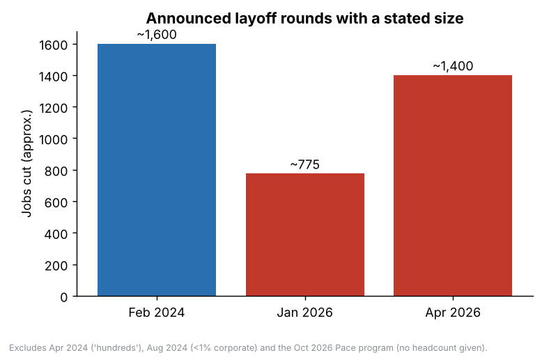

# Nike, Inc. (NYSE: NKE): Turnaround, Leadership and Stock Research

**Prepared:** October 12, 2026 | **Purpose:** Case competition research | **Status:** Working draft, not investment advice

> **How to read this report.** It is written for someone new to finance. Every concept is explained the first time it appears (see also the glossary in Section 14). Every chart carries a data-quality note. Facts are labelled **checked** (matched against search summaries that cite SEC or Nike releases), **approximate** (from memory, not verified), **secondary** (news or aggregator sites), or **my inference** (my own reasoning, not a sourced fact). **Read Section 13 before relying on any number.** None of the SEC pages could be opened directly in this environment, so every figure should be confirmed against the filings before it goes into a final submission.

---

## Table of contents

1. [Executive summary](#1-executive-summary)
2. [Finance primer for beginners](#2-finance-primer-for-beginners)
3. [What Nike is and what went wrong](#3-what-nike-is-and-what-went-wrong)
4. [The strategic shift: Win Now, Sport Offense, Pace](#4-the-strategic-shift-win-now-sport-offense-pace)
5. [The financials, with charts](#5-the-financials-with-charts)
6. [The stock: price, valuation, dividend, analysts](#6-the-stock-price-valuation-dividend-analysts)
7. [People: the leadership thesis](#7-people-the-leadership-thesis)
8. [Executive deep dives: current leadership](#8-executive-deep-dives-current-leadership)
9. [Executive deep dives: departures](#9-executive-deep-dives-departures)
10. [Patterns in the people data](#10-patterns-in-the-people-data)
11. [Scenario framework (illustrative)](#11-scenario-framework-illustrative)
12. [What else to investigate](#12-what-else-to-investigate)
13. [Data quality and open questions](#13-data-quality-and-open-questions)
14. [Glossary](#14-glossary)
15. [Sources](#15-sources)

---

## 1. Executive summary

- **The situation.** Nike is the world's largest sportswear company, and it is shrinking. Revenue peaked at $51.4 billion in FY2024 (approximate) and was **$46.4 billion in FY2026** (checked). Diluted earnings per share (EPS) fell from about $3.73 (approximate) to **$2.10**, and management guided to adjusted EPS of **$1.15 to $1.35** for FY2027 with revenue falling by a **high single digit percentage**.
- **The stock.** About **$34.71** (Oct 9 close, secondary), roughly **80% below** its 2021 intraday high near $179, and near a 13-year low. Analyst consensus is Hold, with targets ranging from $19 to $94.
- **The turnaround.** CEO Elliott Hill (a 32-year Nike veteran who retired in 2020 and returned in October 2024) is running a three-stage plan: **Win Now** (repair retailer relationships, refocus on sport), **Sport Offense** (reorganize around sports), and **Pace** (announced Oct 1, 2026: about $2.5 billion in savings through FY2031 at about $1.0 billion of restructuring cost).
- **The people angle (your thesis idea).** I counted **19 named senior exits since 2020, and 14 of them came after Hill started** (Section 9). Four were roles that Nike eliminated outright. In the same window Nike changed its CFO and its Chief Commercial Officer, and its chief accounting officer also resigned. Hill's outside hires are only in finance and commercial (David Denton, Jane Ewing) and both come from outside sportswear. Everyone else he promoted is a Nike insider or returnee. Section 10 explains why this matters and what it does and does not prove.
- **What to watch next:** Nike Investor Day (**Nov 16 to 17, 2026**) and Q2 FY2027 earnings (about **Dec 17, 2026**).

**Suggested thesis question for your case:** *Is Nike's decline a leadership-and-execution problem that a returning insider team can fix, or a structural problem (competition, China, tariffs, brand fatigue) that leadership changes cannot fix?* The people data (Sections 7 to 10) is the strongest evidence for the first half of that question. The competitor and product evidence (Section 12) is what is still missing for the second half.

---

## 2. Finance primer for beginners

Skip this if you know it. If you do not, read it once, because the rest builds on it.

**A stock** is a small slice of ownership in a company. If Nike has about 1.48 billion shares (approximate, not verified) and each costs $34.71, the market values Nike at roughly **$51 billion** (my arithmetic). That total is called **market capitalization**.

**A stock price is a bet on the future,** not a report on the past. When Nike beats its earnings estimate but guides to falling sales, the stock can still drop, because investors care more about where profits are going than where they have been.

**The income statement in four lines:**
1. **Revenue** (sales): all money from customers.
2. **Gross profit:** revenue minus the direct cost of making and shipping products. **Gross margin** is that as a percent of revenue. Nike's 42.8% means about 43 cents of each sales dollar is left to pay for marketing, salaries, stores, and profit.
3. **Operating profit (EBIT):** gross profit minus selling, marketing, and overhead costs.
4. **Net income:** what remains after interest and taxes. Divided by shares, it becomes **EPS**.

**P/E ratio** is price divided by EPS. It says how many years of current profit you pay for. A *forward* P/E uses next year's expected EPS. High P/Es mean investors expect growth; low P/Es mean they are skeptical or the business is in decline. A P/E can also look high simply because profit is temporarily depressed.

**Dividend yield** is the yearly dividend divided by the price. Nike pays $0.41 per quarter ($1.64 per year), so the yield is about **4.7%** at today's price. The **payout ratio** is dividends divided by earnings. Above 100% means the company pays out more than it earns, which cannot last forever without drawing on cash or borrowing.

**Fiscal year.** Nike's year ends May 31. "FY2026" is June 2025 to May 2026. "Q1 FY2027" is June to August 2026, reported October 1, 2026.

**Basis points (bps):** 100 bps = 1 percentage point. **Currency-neutral** growth strips out exchange-rate effects.

**Guidance** is the company's own forecast. Markets move on guidance more than on past results.

**One-time items.** A good number that will not repeat is not a trend. Example in this report: Nike's Q4 FY2026 margin of 49.2% included a one-time $986 million tariff refund (Section 5).

---

## 3. What Nike is and what went wrong

Nike designs and sells athletic shoes, apparel and equipment under the **Nike**, **Jordan** and **Converse** brands. It sells through two main channels: **wholesale** (retailers such as Foot Locker, Dick's, JD Sports) and **Nike Direct** (its own stores, app and website). Its four geographic regions are North America, EMEA (Europe, Middle East, Africa), Greater China, and APLA (Asia Pacific and Latin America).

**How the decline happened (narrative from the research; ordering of causes is my interpretation):**

1. **The direct-to-consumer bet (2020 to 2023).** Under then-CEO John Donahoe, a technology executive from eBay, PayPal and ServiceNow, Nike pushed its "Consumer Direct Acceleration" plan: more sales through its own channels and fewer through retailers. Revenue grew at first. But Nike pulled back from retail partners, and competitors took the shelf space.
2. **Product fatigue.** Nike leaned heavily on classic franchises (Air Force 1, Dunk, Jordan retros). New innovation slowed. Newer brands such as On and Hoka won running customers.
3. **Donahoe acknowledged the problem.** In early 2024 he publicly said Nike had gone too far from wholesale partners. He announced a roughly $2 billion cost-cutting plan in December 2023.
4. **The break point.** On September 19, 2024, Nike announced Donahoe's retirement after weak guidance. The board brought in Elliott Hill, effective October 14, 2024.
5. **Since then:** the revenue decline continued. Tariffs added cost pressure (estimated at about $1.5 billion annualized at the peak). Greater China weakened sharply. Converse shrank.

**A note on cause and effect.** The sources show correlation in time between strategy changes and results. They do not prove the DTC shift caused the decline; competition and consumer trends played a role. Treat the neat narrative above as a hypothesis the evidence supports, not a proven fact.

---

## 4. The strategic shift: Win Now, Sport Offense, Pace

| Stage | Date | What it is | Evidence of progress |
|---|---|---|---|
| **Win Now** | From Oct 2024 | Rebuild retailer ties, refocus on performance sport (especially running), shrink the Classics business, flatten management | Wholesale revenue growing; running reported as a bright spot (one source: five quarters of double-digit growth, unverified) |
| **Sport Offense** | 2025 | Reorganize about 8,000 staff into teams by sport instead of by product type/channel. Consumer/Product/Brand division split into Consumer and Sport, Marketing, and Product Creation (May 2025) | Too early to isolate its effect |
| **Pace** | Announced Oct 1, 2026 | Supply chain and organization overhaul. About **$2.5 billion cumulative savings** through FY2031 (before charges and reinvestment), about **$1.0 billion** pre-tax charges (about $0.3 billion in FY2027). Moves from four to three geographies (Americas; EMEA; Asia Pacific and Greater China, led from Singapore) from FY2028. New technology campus in Bengaluru, India. Role decisions begin in 2027. | Savings land mostly in FY2029 and FY2030, so no near-term proof |

**Other structural changes (Dec 2025):** a **Chief Operating Officer** role was created for Venkatesh Alagirisamy and absorbed technology; the CTO and Chief Commercial Officer roles were eliminated; Global Sales and Nike Direct moved under the CFO; the four geography heads joined the senior leadership team reporting directly to Hill. In **August to September 2026**, a new CFO (David Denton) and a new Chief Commercial Officer (Jane Ewing) arrived (details in Section 8).

**Layoffs:** about 1,600 (Feb 2024, Donahoe era), about 775 (Jan 2026, distribution centers, citing automation), about 1,400 (Apr 2026, mostly technology). Pace gave no headcount; role decisions start in 2027. Analysts at BNP Paribas called Pace the third restructuring since FY2024 with "no operating leverage" so far (via a Retail Dive snippet, secondary).

**Why Pace matters for a skeptical reader:** analysts read it as extending the turnaround timeline. Management itself says savings arrive in FY2029 to FY2030. A turnaround that needs four more years of cost-cutting before benefits show is a different investment from one that is nearly over.

---

## 5. The financials, with charts

### 5.1 Annual revenue and margin

**What it shows:** revenue rose to $51.4 billion in FY2024 (approximate), then dropped about 10% to $46.3 billion in FY2025 and was flat in FY2026. Gross margin fell from about 44.6% (FY2024) to 42.7% to 42.9%.

**Teaching point:** the *hatched* bars (FY19 to FY24) come from memory and are not verified. The solid bars (FY25, FY26) were matched to search summaries of Nike filings.

### 5.2 Earnings per share

- EPS fell from about $3.73 (FY24, approximate) to **$2.10** (FY26, checked), about **44% lower**.
- FY2026 EPS includes **$0.52 per share** from the one-time tariff recovery in Q4. One third-party summary puts underlying FY26 EPS near **$1.58** (unverified).
- FY2027 guidance midpoint is **$1.25** (adjusted, excluding about $0.15 of Pace cost). That is about **40% below FY26 reported EPS**, partly because FY26 was boosted by the one-time item.

### 5.3 Quarterly view

**Reading the chart:**
- Revenue has hovered around $11 to $12.5 billion per quarter for two years, with no clear upturn.
- **Gross margin has dropped from about 44.7% to the 40% to 43% range.** The spike to 49.2% in Q4 FY26 is the tariff refund. Subtracting the reported 900 bps gives about **40.2%** (my arithmetic), which is the real underlying level.
- The 60 bps margin improvement in Q1 FY27 (to 42.8%) came mostly from lower warehousing and logistics costs, which is the kind of cost-based improvement (not a pricing or demand improvement) that can run out.

### 5.4 Where revenue is shrinking

- **Greater China** fell about 22% in Q1 FY27 (26% currency-neutral). Nike's own filing says China and Converse will keep hurting results throughout FY2027.
- **Converse** fell about 28% in Q1 FY27 and 32% in Q4 FY26. Nike calls this a "strategic reset."
- **Only North America grew** (about +2%), consistent with the wholesale recovery.
- **Nike Direct fell about 8%** while wholesale fell about 1%. This reverses the Donahoe strategy: Nike Direct revenue peaked near $21.5 billion in FY24 (approximate) and was $17.7 billion in FY26.
- **Data caution:** FY26 and Q1 FY27 regional figures come from aggregators and disagree (for example, APLA flat versus down 2%).

### 5.5 Balance sheet snapshot (Aug 31, 2026; checked via search summaries)

| Item | Amount |
|---|---|
| Cash and equivalents | $6.9 billion |
| Short-term investments | $1.5 billion |
| Long-term debt (non-current) | $5.9 billion |
| Current portion of long-term debt | $2.0 billion |
| Shareholders' equity | $15.2 billion |
| Inventories | about $7.8 billion (-3% year over year, +5% since May 31) |

My arithmetic: cash plus short-term investments of about $8.4 billion against long-term debt (current plus non-current) of about $7.9 billion is roughly balanced, before notes payable (not found). Nike paid about **$2.4 billion** in dividends in FY2026 (checked).

**Why inventory matters:** if Nike has more product than customers want, it must discount it, which cuts margin. Morgan Stanley's note (secondary) said that risk is not yet priced in. Inventory is up since May even while sales are down, which is worth monitoring.

---

## 6. The stock: price, valuation, dividend, analysts

### Price facts
- **Last close:** $34.71 on Friday, October 9, 2026 (secondary; October 11 was a Sunday).
- **52-week range:** about $31.97 to $70.44. **All-time high:** about $179 (Nov 5, 2021, intraday).
- Down about **45% in 2026** and about **80% from the high** (my arithmetic: 34.71 / 179.10 = 19.4% of the peak).
- Nike left the **S&P 100** index effective Sept 21, 2026. Index changes can force fund selling and are symbolic.
- **Data caution:** year-end prices before 2025 are from memory; the Dec 2025 price is derived from a reported "-46% year to date" figure.

### What happened on October 1 to 2, 2026
Nike beat on EPS ($0.48 vs about $0.43 expected) but missed on revenue ($11.21 billion vs $11.32 billion) and guided to a high-single-digit revenue decline for FY27. Shares hit a 13-year low. Sources disagree on the size of the move (about 2% to 9% depending on timing). Morgan Stanley cut its target to **$27** (Underweight), saying revenue quality was low. J.P. Morgan and Bank of America also have sell-equivalent ratings. Jefferies stayed at Buy with a $60 target.

### Valuation arithmetic (mine, so check it)
| Measure | Calculation | Result |
|---|---|---|
| Forward P/E on guidance midpoint | $34.71 / $1.25 | about **28x** |
| Dividend yield | $1.64 / $34.71 | about **4.7%** |
| Payout vs. guided EPS | $1.64 / $1.25 | about **131%** |
| Payout vs. FY26 reported EPS | about $1.62 / $2.10 | about 77% |
| Approx. market cap | 1.48B shares x $34.71 | about **$51 billion** (share count unverified) |

**Teaching point:** a 28x P/E is expensive for a shrinking company. It looks that way because profit is temporarily depressed. The bull case needs earnings to recover substantially. The bear case says they might not.

**Dividend risk:** if FY27 EPS lands near $1.25, the $1.64 dividend exceeds earnings. Nike has raised its dividend for 24 consecutive years (secondary), so cutting it would be a significant signal. No cut has been announced; this is a risk, not a prediction.

### Analyst views
- Consensus **Hold**; 12-month targets average about **$38** to **$41**, ranging from **$19 to $94** (secondary). A spread this wide means analysts disagree on what the business is worth.
- Rating split from one aggregator (27 analysts): 19% Strong Buy, 15% Buy, 48% Hold, 19% Sell.

### Upcoming catalysts
- **Investor Day: Nov 16 to 17, 2026** (Pace details and long-term targets are likely).
- **Q2 FY27 earnings: about Dec 17, 2026** (watch the 400 bps headwind from last year's Cyber Week promotions and higher North America retailer stocking).

---

## 7. People: the leadership thesis

**Why people are a useful indicator.** In a turnaround, financial results lag. Leadership decisions (who is hired, who is promoted, who is removed, who leaves voluntarily) show what management believes and what the board thinks of it. They are also easier to observe in real time than product success. This section treats people as a *leading indicator*, with the caveat that **leadership changes can signal either decisive repair or instability, and the facts alone cannot tell the two apart.**

**Three questions to ask of every executive move:**
1. Was it **planned** (a retirement with a named successor) or **abrupt** (a role eliminated, no stated reason)?
2. Does the **replacement** come from inside Nike or outside, and does the background fit the problem being solved?
3. Does it **reduce** layers of management (faster decisions) or **create** new ones?

**Leadership eras (checked unless noted):**

| Era | CEO | Background | Philosophy |
|---|---|---|---|
| 2006 to Jan 2020 | **Mark Parker** | Joined 1979 as a footwear designer | Product-led |
| Jan 2020 to Oct 2024 | **John Donahoe** | Outsider (Bain, eBay, PayPal, ServiceNow); joined Nike's board in 2014 | Digital/direct-to-consumer, data, membership |
| Oct 2024 to now | **Elliott Hill** | Nike lifer (1988 to 2020), retired, then returned | Sport-first, wholesale partnerships, veteran team |

---

## 8. Executive deep dives: current leadership

**Confidence tags:** HIGH = multiple consistent sources; MED = single or partly conflicting source; LOW = inferred. No official full leadership roster was found, so this list is assembled from announcements. Full sources are in `research_notes/02_current_exec_team.md` and `research_notes/01_ceo_and_board.md`.

### Elliott Hill, President and CEO (since Oct 14, 2024)
- **Career:** joined Nike June 1, 1988 (campus recruiting at Ohio University; early sports-graphics sales role in 1989, team sales in 1991, director of the Team Sports Division in 1998). Rose to **President of Consumer and Marketplace in 2018**, overseeing all commercial and marketing operations for Nike and Jordan. Mid-career titles (EMEA role around 2000, "President, Geographies" around 2016) come from one aggregator and are **unverified**.
- **Leaving:** retired in June 2020, a few months after Donahoe arrived. Hill has said it was not because he was passed over; he cited needing a break. (HIGH on the date; the stated reason is Hill's own account.)
- **Interlude (2020 to 2024):** board seats (Weber, TCU), senior advisor roles at merchant banks (BDT & MSD Partners), and his own firm (MED, aggregator sources).
- **Return:** In summer 2024 Parker phoned him; conversations "went from light to a lot heavier very quickly." The board had weighed other internal and external candidates first, partly unsure Hill was interested. Announced Sept 19, 2024.
- **What changed in his career:** from commercial executive to CEO; from retiree back to the top job after four years away.
- **What he did on arrival:** reversed Donahoe's structure (sport-based teams instead of gender-based), rebuilt wholesale ties, brought back veterans, and reshuffled the senior team repeatedly (Section 9).
- **Signal (my inference):** Hill's playbook is "put the band back together." Of the senior people named in Section 8, only two are outside hires.

### David Denton, EVP and Chief Financial Officer (started Aug 17, 2026; outside hire by Hill)
- **Career:** CFO of **Pfizer** (May 2022 to 2026); CFO of **Lowe's** (2018 to 2022); about two decades at **CVS Health** including EVP and CFO; earlier Deloitte (one LinkedIn-based source, MED). Boards: Tapestry (2014 to 2023), Haleon (2023 to 2024). Education: Kansas State and Wake Forest MBA (MED).
- **Why hired:** Hill called him a proven public-company CFO who can help consumer brands "operate with discipline and invest to win."
- **Also:** interim corporate controller and principal accounting officer after Johanna Nielsen resigned as chief accounting officer effective Sept 4, 2026 (8-K dated Aug 4, 2026).
- **What is notable:** his whole career is outside sporting goods (healthcare, pharmacy retail, home improvement). He arrived six weeks before Pace was announced.
- **Open question:** Marketplace (Sales and Nike Direct) moved under the CFO in Dec 2025, then reportedly under the new CCO. Whether it left his remit is my inference (LOW).

### Venkatesh Alagirisamy, EVP and Chief Operating Officer (since Dec 8, 2025; insider promoted by Hill)
- **Career:** i2 Technologies consultant; joined Nike in **2006** as a process manager in supply chain; demand planning, inventory, global operations; VP Global Operations; **COO of Converse**; **Chief Supply Chain Officer** (from about 2020); COO in Dec 2025, absorbing technology after the CTO role was eliminated. Education: Purdue MS, Duke MBA, BITS Pilani BE.
- **What he owns:** supply chain, planning, operations, sustainability, technology. He authored the April 2026 memo on consolidating technology teams in Beaverton and India.
- **Signal:** a supply-chain operator now runs both operations and technology, which is consistent with Pace's operational focus.

### Jane Ewing, EVP and Chief Commercial Officer (started Sept 7, 2026; outside hire by Hill)
- **Career:** about 14 years at **Walmart** (merchandising, digital, international; most recently interim CEO of **Sam's Club China**); earlier at Diageo (one source, MED). Her first job was selling Nike product in a sporting-goods store (per Nike's bio).
- **What she owns:** global Marketplace (Sales and Nike Direct). Predecessor role (Craig Williams) was eliminated in Dec 2025, so this is a **re-created** role under a new person.
- **Signal (my inference):** a China-experienced retailer, hired into the channel that is declining fastest. The hire follows the Greater China head's departure.

### Amy Montagne, President, Nike Brand (promoted May 2025)
- **Career:** about 20 years at Nike; most recently VP/GM Global Women's; earlier VP/GM roles in APLA, Global Men's, Global Categories, and Global Merchandising. Before Nike: planning and merchandising at Gap, Mervyn's, and Walmart (MED).
- **Context:** took on part of the portfolio of Heidi O'Neill after the three-way split.

### Phil McCartney, EVP, Chief Innovation, Design and Product Officer (May 2025)
- **Career:** joined Nike about 1997 to 1998 in the UK; Key Account Director at JD Sports (1999 to 2002, a retail customer); product director for Global Running (2005 to 2010); VP Global Footwear Football; VP/GM Nike Footwear (2016 to 2020); VP Global Footwear, Product and Merchandising (2020 to 2025). Timeline from an aggregator (MED), promotion date HIGH.
- **Signal (my inference):** a product person with running and football backgrounds heads product, matching the sport-first plan. He took over the innovation remit of retiring John Hoke; his deputy, Andy Caine, replaced Tony Bignell (who left April 2026 after under a year).

### Nicole Hubbard Graham, EVP and Chief Marketing Officer
- **Career:** about 18 years at Nike; left in 2021 to co-found creative agency Adopt; **returned as CMO in late 2023**, so this was **not a Hill hire** (Donahoe era). Hill kept and elevated her to EVP in May 2025. Return date varies by source (late 2023 vs January 2024).

### Tom Clarke, Chief Growth Initiatives Officer (role created May 2025)
- **Career:** joined Nike in **1980** as Director of Biomechanics Research; President and COO 1994 to 2000; President of Innovation for about 11 years; strategic advisor to the CEO. **Current status in Oct 2026 not verified (LOW).**

### Regional heads (on the senior leadership team since Dec 2025)
| Region | Leader | Background | Hill link |
|---|---|---|---|
| North America | **Tom Peddie** (VP/GM) | About 30 years at Nike, retired 2020, **rehired June 2024** to repair retailer relationships, named GM Oct 21, 2024 replacing Scott Uzzell | Returnee; attribution to Hill is MED |
| Greater China | **Cathy Sparks** (VP/GM, Jan 2026) | 25-year veteran; started in retail at Niketown Portland; previously VP/GM APLA | Hill-era; replaced **Angela Dong** (led China since 2005; left Mar 31, 2026) |
| EMEA | **César Garcia** (VP/GM, Feb 2, 2026) | About 25 years; started in Spain; ran APLA, Global Running, Western Europe | Replaced retiring **Carl Grebert** (about 30 years) |
| APLA | **Cristin (Crissy) Campbell** (interim) | About 15 years; began as a graduate intern | Interim; permanent status unverified |

### Brand and functional leaders
- **Sarah Mensah, President, Jordan Brand** (since May 2023; **not Hill's hire**). Former VP/GM North America; spent 19 years with the NBA's Trail Blazers (SVP and COO) before Nike. Albertsons director since Dec 2023. Hill said Jordan oversupplied retro product and that volume would be cut (Q1 FY27 call). Status in Oct 2026 appears unchanged but absence of news is not proof (MED).
- **Aaron Cain, CEO, Converse** (since July 2025, replacing Jared Carver after about two years). Joined Nike in 2004 as director of global apparel strategy; held GM roles including Greater China Sportswear and Global Men's. Converse revenue was $1.7 billion in FY25 (down 19%) and kept falling.
- **Treasure Heinle, EVP and Chief People Officer** (Jan 6, 2025, succeeding Monique Matheson). Joined 2012; was Chief Talent Officer from 2022. Prior HR roles at Danaher, Tektronix, InFocus (MED).
- **Rob Leinwand, EVP and Chief Legal Officer** (late 2024, succeeding Ann Miller). Joined 2004; earlier at the law firm Littler Mendelson; Cornell degrees.
- **Ann Miller, EVP, Global Sports Marketing** (moved from legal in Oct 2024 to succeed John Slusher). Current status unverified (LOW).
- **Running and sport leaders:** no named running or sport leads found at person level. This is a gap. Given that running is the core of the turnaround story, naming these people should be a priority.

### Board of directors (not executives, but key decision-makers)
- **Mark Parker, Executive Chairman** (CEO 2006 to Jan 2020; joined 1979 as a footwear designer). Picked Donahoe (2019) and then Hill (2024); in my judgment accountability for both choices sits with him. That is inference, not a sourced claim.
- **Board changes:** Jorgen Vig Knudstorp (former LEGO CEO) joined in 2025 as Cathleen Benko retired; **Alexandre Arnault** (Deputy CEO of Moet Hennessy, LVMH board) was appointed Sept 16, 2026; John Rogers Jr. (Ariel Investments) retires from the board at the Sept 2026 meeting and becomes a strategic advisor.
- **Unverified:** the full roster, who is lead independent director (Tim Cook held the role in 2016; his current status is unconfirmed), and Phil Knight's founder-control details.
- **Signal (my inference):** two recent additions come from consumer brands and luxury (LEGO, LVMH), which suggests the board wants brand-building expertise.

### Past CEO: John Donahoe (CEO Jan 2020 to Oct 2024)
- **Career:** Bain & Company (20+ years; CEO of Bain 1999 to 2005); eBay (president of eBay Marketplaces 2005; CEO 2008 to 2015); chair of PayPal's board (2015 to 2024); CEO of ServiceNow (2017 to 2020). Joined Nike's board in 2014. Named CEO in Oct 2019 through a succession process led by board member Tim Cook.
- **At Nike:** Consumer Direct Acceleration (June 2020), shuffled leadership multiple times (July 2020, May 2023), announced a $2 billion cost-cutting plan (Dec 2023), and in early 2024 conceded Nike had gone too far from wholesale.
- **Exit:** retirement announced Sept 19, 2024, after weak guidance and a sharp stock drop. Nike said it was not due to disagreement; he served as an advisor into January 2025. A class action alleged Donahoe and Friend misled investors on direct-to-consumer success (allegation, not a finding).
- **Afterwards:** named **Stanford athletics director** (July 31, 2025).
- **Hires:** specific Donahoe hires were **not verified** in this research. Several executives (Friend, O'Neill, Williams, Mensah, Graham, Dogan) were in senior roles in his era, but who personally hired whom was not confirmed.

---

## 9. Executive deep dives: departures

*Counts people named in this research, not a complete census. Dates are announcement or effective months and vary by source. Official reasons are separated from reported reasons below.*

| Person | Role and tenure | Date | Official reason | Reported/other | Next | Successor |
|---|---|---|---|---|---|---|
| **Eric Sprunk** | COO | Retire (announced Feb 12, 2020) | Retirement | n/a | Unknown | Andy Campion |
| **Elliott Hill** | President, Consumer & Marketplace | Retired 2020 | Retirement | His own account: needed a break | Returned as CEO Oct 2024 | Heidi O'Neill (consumer business) |
| **Ann Hebert** | VP/GM North America | Mar 1, 2021 | Nike: her decision | Bloomberg report tied her son's sneaker resale business to her credit card; O'Neill later said "together with Ann, we decided" | Unknown | Sarah Mensah (NA), Amy Montagne (APLA) |
| **Andy Campion** | CFO then COO, later strategic ventures | Apr 5, 2024 | No reason given; $2.75M separation payment | Link to cost cuts is inferred only | Program director, UCLA Anderson (sports leadership) | n/a |
| **John Donahoe** | CEO | Announced Sept 19, 2024 | "No disagreement" | Followed weak guidance and a record-bad trading day | Stanford athletics director | Elliott Hill |
| **John Slusher** | Global Sports Marketing (26 years) | Announced Oct 30, 2024 | Retirement | One of four 26-plus-year veterans leaving after Hill arrived | Unknown | Ann Miller |
| **Monique Matheson** | CHRO (26 years) | Jan 6, 2025 | Retirement | Same cluster | Unknown | Treasure Heinle |
| **Daniel Heaf** | Chief Strategy & Transformation Officer | About Mar 19, 2025 | Role eliminated (per internal memo reported by Bloomberg) | Functions folded into finance | Unknown | None |
| **KeJuan Wilkins** | Chief Communications Officer (about 20 years) | About Mar 19, 2025 | No public statement | Reason not found | Unknown | None named |
| **Heidi O'Neill** | President, Consumer, Product & Brand (26 years) | Role eliminated May 2025; retired Sept 2025 (one source) | Retirement | Role split into three parts. Business of Fashion headline said "out" | **CEO of Lululemon** (announced Apr 23, 2026; starts Sept 8, 2026) | Role split; Amy Montagne became Nike Brand president |
| **Jared Carver** | CEO, Converse (joined 2023) | July 2025 | No reason found | Converse sales weak | Unknown | Aaron Cain |
| **John Hoke** | Chief Innovation Officer (33 years) | Stay through Oct 31, 2025 | Retirement | Same May 2025 batch | Unknown | Phil McCartney (took remit) |
| **Muge Dogan** | Chief Technology Officer (joined 2023 from Amazon) | Dec 2, 2025 | Role eliminated | Hill: remove layers, integrate tech into Sport Offense | Unknown | COO took technology |
| **Craig Williams** | Chief Commercial Officer (ex-Coca-Cola; ex-Jordan Brand president) | Role eliminated Dec 2, 2025; separated Apr 6, 2026 | Role eliminated | Sales and Direct moved to CFO | Unknown | Jane Ewing (new CCO, Sept 2026) |
| **Carl Grebert** | EMEA head (about 30 years) | Announced Jan 20, 2026 | Retirement | "Long-underway succession planning" | Unknown | César Garcia |
| **Angela Dong** | Greater China head (since 2005) | Mar 31, 2026 | Stepping down | Bloomberg: "bid to recapture growth" | Unknown | Cathy Sparks |
| **Tony Bignell** | Innovation chief (under a year) | Effective Apr 5, 2026 | "To pursue creative and philanthropic passions" | Analyst called it a "real surprise" | Unknown | Andy Caine |
| **Matthew Friend** | EVP and CFO (CFO since Mar 2020; 17+ years at Nike) | Handoff Aug 17, 2026; separated Sept 4, 2026 | Not due to disagreement with management or board | Analysts called it a surprise; no reason given | Unknown | David Denton |
| **Johanna Nielsen** | Chief Accounting Officer | Effective Sept 4, 2026 | Resigned (8-K Aug 4, 2026) | Reason not found in sources | Unknown | David Denton as interim controller |

**Friend's career (since the CFO exit matters):** about a decade in investment banking and M&A (Goldman Sachs, Morgan Stanley), then joined Nike in 2009 in corporate strategy; CFO of Emerging Markets, then Global Categories/Product/Functions, then Nike Brand, then Nike CFO. Sits on the board of United Airlines. Reason for leaving was not stated in any source seen.

**Names checked that did not turn out to be departures:** Tom Clarke (appointed Chief Growth Initiatives Officer May 2025), Cathy Sparks (promoted), Larry Miller (Jordan; no retirement found). **Not found:** Kellie Leonard; the "Tim Hardaway-era" reference from the research brief could not be matched to anyone.

**2018 context (outside the window):** Trevor Edwards and Jayme Martin left in 2018 during a workplace-conduct probe, which is part of why Nike's culture and senior bench have been scrutinized.

---

## 10. Patterns in the people data

**These are my observations from the evidence. Each is labelled with how strong it is.**

1. **The exits accelerate after the CEO change (strong, counts are checked).** 5 of the 19 named exits happened before Hill took over (2020 to Sept 2024); 14 happened after. In calendar 2025 alone there were eight named exits. *Caution:* a new CEO normally reshapes the team, and many exits were announced retirements of 26-year to 33-year veterans. A "retirement wave" is a healthy handover in some reading and a purge in another.

2. **"Role eliminated" is a distinct signal (strong).** Four exits were flagged as eliminated roles (Heaf, O'Neill, Dogan, Williams). Their functions (strategy, consumer/product/brand president, CTO, chief commercial officer) were merged into others, then partly re-created (Ewing's CCO job in Sept 2026 is close to Williams's old one). That suggests the Dec 2025 restructuring needed adjusting within nine months. *My inference:* this may reflect learning (a layer was removed, then a needed capability restored) or indecision.

3. **Hill promotes insiders and veterans (strong).** Montagne, McCartney, Alagirisamy, Sparks, Garcia, Campbell, Cain, Heinle, Leinwand, and rehired Peddie are all long-tenured Nike people. This is consistent with the "put the band back together" approach and the Win Now idea that Nike lost its way by moving away from product and sport. *The risk:* the people who ran Nike while it declined are among those now fixing it, and Greater China's new head is a 25-year insider following a head who led China for 20 years.

4. **Outside hires are in finance and commercial, both from non-sport sectors (strong).** Denton (pharma, retail) and Ewing (Walmart) are imports from big-operations, discipline-focused backgrounds. *My inference:* management believes it needs retail and cost discipline from outside, while believing product and brand knowledge must come from inside.

5. **Finance turned over in a single quarter (strong on facts, unknown cause).** In June 2026 Nike announced the CFO transition. By Aug 17 Denton was CFO, and Friend left Sept 4. A separate 8-K reported the chief accounting officer's resignation effective the same day. Nike said Friend's exit was not due to a disagreement. **I found no evidence of any accounting problem, and I am not suggesting one.** But a two-person turnover at the top of finance just before a $2.5 billion restructuring announcement is a pattern a diligent analyst would flag and ask about at Investor Day.

6. **Talent moving to other consumer brands (medium).** Heidi O'Neill, a 26-year Nike executive who had been President of Consumer, Product and Brand, became CEO of Lululemon (starts Sept 2026). One source mentions another ex-Nike VP becoming Lululemon's chief product officer (Oct 2026, LOW). *My inference:* strong Nike alumni are valued elsewhere, but Nike lost the senior talent it was trying to keep.

7. **Greater China leadership change after revenue declines (medium).** The head of China for about 20 years left; a retail veteran from Walmart's China business now leads the channel side; the Chinese partner-run online channel will be shut in January 2027. This is a restructuring of the weakest region with a mix of insider and outsider leaders.

8. **The board chose both CEOs (strong).** Parker and the board picked an outsider in 2019 and an insider in 2024. The board's own track record matters when judging whether the current plan will hold. New board members from LEGO and LVMH point toward brand expertise.

**What the people data does *not* tell you:** it does not show whether the products are better, whether customers are returning, or whether Nike will regain share against On, Hoka, Adidas, and local Chinese brands. For that you need the evidence in Section 12.

---

## 11. Scenario framework (illustrative)

**This chart is a demonstration of method only. The EPS and P/E inputs are placeholder assumptions I chose, not forecasts and not sourced.** Replace them before using any of this in a recommendation.

**How the method works:** a stock price roughly equals the **EPS** investors expect in the future times the **P/E multiple** they will pay. Bear, base and bull cases choose different EPS and P/E combinations.

| Case | FY28 EPS (placeholder) | P/E (placeholder) | Implied price | What would have to be true |
|---|---|---|---|---|
| Bear | $0.95 | 22x | about $21 | Revenue keeps falling; discounting hurts margin; dividend cut |
| Base | $1.90 | 19x | about $36 | Revenue stabilizes; Pace savings begin; China bottoms |
| Bull | $2.80 | 18x | about $50 | Running and wholesale rebound; margins recover toward 44%; Converse and China stabilize |

**To make this defensible** you need sourced assumptions for revenue growth by region, gross margin, operating expenses after Pace savings, share count, and a justified P/E range based on comparable companies.

---

## 12. What else to investigate

Ordered by value for a case competition built on the leadership thesis:

1. **Product and innovation evidence.** Running share versus On, Hoka, and Adidas; new franchise launches; share of revenue from products under 12 months old; reviews and sell-through.
2. **Competitor benchmarks.** Adidas ran a similar turnaround (a useful timeline benchmark). Also Puma, Lululemon, New Balance, Asics, Deckers (Hoka), On, and Anta/Li-Ning in China.
3. **Retailer signals.** What Foot Locker, Dick's, and JD Sports say on their own earnings calls (retailers see demand before Nike reports it).
4. **Consumer and brand health.** Web traffic, app downloads, search trends, resale prices (StockX, GOAT), and social sentiment.
5. **Inventory and discounting.** Inventory days, Nike.com and outlet promotions.
6. **China.** Local brand competition, the January 2027 change to partner online channels (Topsports says online Nike is about 22% of its revenue, Pou Sheng about 15%), and consumer sentiment.
7. **People gaps to close.** Running and sport leaders at person level; Tom Clarke's and Ann Miller's current roles; Donahoe's specific hires; the full board and lead independent director; where departed executives went; employee sentiment and retention trends.
8. **Primary documents.** FY2026 10-K ("Information about our Executive Officers"), 2026 proxy statement (DEF 14A), the Oct 1, 2026 8-K and 10-Q, the Aug 27, 2026 leadership release, and the Investor Day materials (Nov 16 to 17).

---

## 13. Data quality and open questions

**Read this before using any number.**

- **No SEC filing was opened.** All agents and my own searches could not reach sec.gov, nike.com, bloomberg.com, retaildive.com, and several others (DNS or proxy blocks). Everything comes from search-result summaries that cite those pages.
- **Verification levels** (also in `research_notes/04_financial_data_pack.md`):
  - *Checked against search summaries:* FY2025 and FY2026 annual results; quarters from Q3 FY25 through Q1 FY27; Aug 31, 2026 cash, debt, and equity.
  - *From model memory, not verified:* FY2019 to FY2024 annual figures; Q1 FY24 through Q2 FY25; FY23 to FY24 geography; most year-end stock prices; FY19 to FY22 dividends.
  - *Derived by me:* Dec 2025 stock price (about $63.6), ex-tariff Q4 margin (about 40.2%), P/E, payout ratio, market cap.
  - *Not found:* shares outstanding, notes payable, several dividend years, and wholesale revenue for FY25 and FY26.
- **Conflicts between sources:**
  - Greater China decline in Q1 FY27: 22% (reported) versus 26% (currency-neutral); Q4 FY26 cited as -12% or -17%.
  - APLA Q1 FY27: flat versus -2%.
  - Stock reaction to the Oct 1 earnings: from about -2% to -9%.
  - Dates of exits (announced versus effective); layoff counts (about 1,400 comes from a single-outlet figure in one source and CNBC in another); Friend's effective date (Aug 16 versus Aug 17; Nike says Aug 17).
  - Analyst consensus EPS and forward P/E (16.6 vs 25.7 depending on source and estimate).
- **People-research limits:** no named running or sport leaders; destinations of most departed executives unknown; Donahoe's hires unverified; several reasons for exits are simply not stated.
- **One agent reported a "Hartley as chief strategy officer (Apr 2025)" item that conflicts with Heaf's role elimination date. I left Hartley out because the dates did not reconcile.**
- **Nothing in this report is investment advice.** The scenario chart is a method illustration only.

---

## 14. Glossary

| Term | Meaning |
|---|---|
| **8-K** | A filing public companies submit to the SEC to announce material events (e.g., executive changes). |
| **10-K / 10-Q** | Annual and quarterly financial reports filed with the SEC. |
| **Basis point (bps)** | 1/100 of a percentage point. |
| **Bull / bear case** | Optimistic / pessimistic scenario. |
| **Currency-neutral** | Growth excluding exchange-rate effects. |
| **DTC / Nike Direct** | Selling directly to customers (own stores, app, website). |
| **EBIT** | Earnings before interest and taxes (operating profit). |
| **EPS** | Earnings per share. |
| **Fiscal year (FY)** | Nike's runs June 1 to May 31. |
| **Gross margin** | (Revenue minus cost of goods) divided by revenue. |
| **Guidance** | Company forecast of its own results. |
| **IEEPA tariffs** | Tariffs imposed under an emergency-powers law. Nike booked a $986M expected recovery in Q4 FY26. |
| **Market cap** | Share price times shares outstanding. |
| **P/E ratio** | Price divided by EPS. |
| **Payout ratio** | Dividends divided by earnings. |
| **Proxy statement (DEF 14A)** | Annual filing describing the board, executive pay, and shareholder votes. |
| **Sell-through** | The pace at which retailers sell Nike product to consumers. |
| **Sell-in** | Nike's shipments to retailers. |
| **Wholesale** | Selling through other retailers. |
| **Yield** | Annual dividend divided by price. |

---

## 15. Sources

All links below were surfaced by web search. Most primary pages could not be opened directly, so check them before citing. Complete per-claim links are inside `research_notes/`.

**Company filings and releases**
- [Q4 FY26 earnings release (SEC)](https://www.sec.gov/Archives/edgar/data/320187/000032018726000076/q4fy26exhibit991er.htm)
- [Q1 FY27 earnings release (SEC)](https://www.sec.gov/Archives/edgar/data/0000320187/000032018726000184/q1fy27exhibit991er.htm)
- [Q1 FY27 10-Q (SEC)](https://www.sec.gov/Archives/edgar/data/0000320187/000032018726000193/nke-20260831.htm)
- [FY2026 annual report (SEC)](https://www.sec.gov/Archives/edgar/data/0000320187/000130817926000376/nke015577-ars.pdf)
- [Sept 2024 CEO transition 8-K (SEC)](https://www.sec.gov/Archives/edgar/data/320187/000032018724000053/nke-20240919.htm)
- [Dec 2025 senior leadership announcement (SEC)](https://www.sec.gov/Archives/edgar/data/320187/000032018725000115/sltannouncement.htm)
- [CFO transition release (Nike)](https://about.nike.com/en/newsroom/releases/nike-inc-announces-planned-cfo-transition)
- [Aug 27, 2026 leadership release (Nike)](https://about.nike.com/en/newsroom/releases/nike-inc-august-27-2026-senior-leadership-announcement)

**News and analysis**
- [CNBC: Nike falls to 13-year low](https://www.cnbc.com/2026/10/02/nike-falls-to-13-year-low-analysts-say-the-selling-isnt-over-yet.html)
- [Forbes: Nike shares hit new 13-year low](https://www.forbes.com/sites/antoniopequenoiv/2026/10/01/nike-shares-hit-new-13-year-low-after-q1-revenue-falls-short-of-expectations/)
- [WWD: Elliott Hill at annual shareholder meeting](https://wwd.com/footwear-news/shoe-industry-news/nike-annual-shareholder-meeting-ceo-elliott-hill-progress-1239201228/)
- [Fortune: Elliott Hill turnaround profile](https://fortune.com/article/nike-ceo-veteran-elliott-hill-turnaround-growth/)
- [CNBC: Nike CEO change, Sept 2024](https://www.cnbc.com/2024/09/19/nike-ceo-john-donahoe-is-out-replaced-by-elliott-hill.html)
- [Retail Dive: leadership changes under Hill](https://www.retaildive.com/news/nike-ceo-elliott-hill-leadership-team-turnaround-changes/750495/)
- [Retail Dive: CTO and CCO roles cut](https://www.retaildive.com/news/nike-cuts-chief-technology-commercial-officer-roles-leadership-overhaul/806913/)
- [Retail Dive: CFO change](https://www.retaildive.com/news/nike-surprise-cfo-change-david-denton-turnaround-progress/823650)
- [CNBC: Nike layoffs, Apr 2026](https://www.cnbc.com/2026/04/23/nike-job-cuts-layoffs.html)
- [SGI Europe: China partner online sales](https://www.sgieurope.com/distribution/nike-to-rejigger-online-sales-in-china-after-all/122359.article)
- [StockAnalysis: analyst forecasts](https://stockanalysis.com/stocks/nke/forecast/)
- [Investing.com: NKE price](https://www.investing.com/equities/nike)
- [Simply Wall St: NKE analysis](https://simplywall.st/stocks/us/consumer-durables/nyse-nke/nike)

---

## Repository contents

| Path | What it is |
|---|---|
| `REPORT.md` | This report |
| `charts/` | The 10 chart images used above |
| `scripts/make_charts.py` | Reproduces every chart; data and quality flags are inside the script (`pip install matplotlib`, then `python3 scripts/make_charts.py`) |
| `research_notes/` | Raw research notes from four parallel research passes, with inline source URLs and confidence tags |
