# Nike, Inc. (NYSE: NKE): Turnaround, Leadership and Stock Research

**Prepared:** October 12, 2026; updated October 13, 2026 (Sections 5.7 to 5.12 added) | **Purpose:** Case competition research | **Status:** Working draft, not investment advice

> **How to read this report.** It is written for someone new to finance. Every concept is explained the first time it appears (see the glossary in Section 14).
>
> **Every financial number in this version comes from Nike's SEC filings**, which were downloaded from sec.gov (and, from October 13, 2026, from Nike's investor-site copy of the same EDGAR filings) and read in full: the FY2019 to FY2026 10-Ks, the 10-Qs from Q1 FY2024 to Q1 FY2027, every quarterly earnings release (8-K Exhibit 99.1) from Q4 FY2019 to Q1 FY2027, the 2026 proxy statement, and the 2024 to 2026 leadership and restructuring 8-Ks. Each number carries a citation in the form **(FY26 10-K p. 32)**, where the page is the printed page number in the filing. Earnings releases have no printed page numbers, so their pages are counted from the first page of the press release. Every value was machine-checked to appear on the cited page. The cell-level record (filing, page, URL and a verbatim quote) is `data/nike_filing_facts.csv`, and the tables are in `research_notes/04_financial_data_pack.md`.
>
> **Non-filing facts are labelled.** *Market data* (share prices) comes from the Yahoo Finance price feed (`data/nke_daily_prices.csv`). *Nike release* means a page on about.nike.com or investors.nike.com that was opened and read. *Secondary* means a news or aggregator page that was opened and read. *My arithmetic* and *my inference* mark my own calculations and reasoning. Section 13 lists what changed from the previous draft.

---

## Table of contents

1. [Executive summary](#1-executive-summary)
2. [Finance primer for beginners](#2-finance-primer-for-beginners)
3. [What Nike is and what went wrong](#3-what-nike-is-and-what-went-wrong)
4. [The strategic shift: Win Now, Sport Offense, Pace](#4-the-strategic-shift-win-now-sport-offense-pace)
5. [The financials, with charts](#5-the-financials-with-charts) (5.7 to 5.10 regional profit, channel economics, Converse and product; 5.11 revenue streams; 5.12 Jordan Brand, the evidence test and valuation; 5.13 five definitive tests of the supply cut and full-price recovery)
6. [The stock: price, valuation, dividend, analysts](#6-the-stock-price-valuation-dividend-analysts)
7. [People: the leadership thesis](#7-people-the-leadership-thesis)
8. [Executive deep dives: current leadership](#8-executive-deep-dives-current-leadership)
9. [Executive deep dives: departures](#9-executive-deep-dives-departures)
10. [Patterns in the people data](#10-patterns-in-the-people-data)
11. [Scenario framework (illustrative)](#11-scenario-framework-illustrative)
12. [What else to investigate](#12-what-else-to-investigate)
13. [Data quality and what changed in this version](#13-data-quality-and-what-changed-in-this-version)
14. [Glossary](#14-glossary)
15. [Sources](#15-sources)

---

## 1. Executive summary

- **The situation.** Nike is the world's largest sportswear company, and it is shrinking. Revenue peaked at **$51,362 million in FY2024** (FY24 10-K p. 57) and was **$46,398 million in FY2026** (FY26 10-K p. 55). Diluted earnings per share (EPS) fell from **$3.73** to **$2.10** over the same two years (FY24 10-K p. 57; FY26 10-K p. 55), and FY2026 included a one-time **$0.52** per share tariff-refund benefit in the fourth quarter (Q4 FY26 release p. 1). For FY2027, Nike expects revenue to "decline high-single digits" and adjusted EPS of **$1.15 to $1.35** (Q1 FY27 release p. 1).
- **The stock.** NKE closed at **$35.35 on October 12, 2026**, which is **80% below** its record close of $177.51 on November 5, 2021 and down 44.5% since the end of 2025 (market data; my arithmetic). The October 2, 2026 close of $33.87 was the lowest since September 2013 (market data). The proxy's own shareholder-return measure says $100 invested at the end of FY2021 was worth **$36.47** at the end of FY2026, against $48.36 for the Dow Jones U.S. Footwear index (2026 proxy p. 56).
- **The turnaround.** CEO Elliott Hill, a 32-year Nike veteran who retired in 2020, returned on October 14, 2024 (8-K filed Sept 19, 2024, p. 2). His plan has three stages: **Win Now**, **Sport Offense**, and **Pace**. Pace was announced October 1, 2026 and targets "approximately $2.5 billion in cumulative savings through fiscal 2031" at "approximately $1.0 billion of pre-tax charges" (8-K filed Oct 1, 2026, Item 2.05, p. 2).
- **The people angle (the thesis idea).** I count **19 named senior exits since 2020, 14 of them after Hill started** (Section 9). Three were roles Nike said it eliminated (O'Neill, Dogan and Williams), and a fourth (Heaf) was reported as eliminated. Within a single quarter Nike also changed its CFO (8-K filed June 23, 2026) and its chief accounting officer resigned (8-K filed Aug 10, 2026). Hill's senior outside hires are **three**: Michael Gonda (communications, from McDonald's), David Denton (CFO, from Pfizer) and Jane Ewing (commercial, from Walmart). Nearly everyone else he promoted is a Nike insider or returnee.
- **Shareholders are pushing back.** Support for executive pay fell to about **67.8%** at the September 2026 annual meeting, from about 94% in 2025 (8-K filed Sept 10, 2026, p. 2; 2026 proxy p. 23; my arithmetic on votes for versus against).
- **Where the money is made (new, Sections 5.7 to 5.10).**
  - **Greater China:** its EBIT margin fell from 39.1% in FY2021 to 21.9% in FY2026, and it had the largest reported EBIT decline of any segment from FY2024 to FY2026 (-$1,031 million).
  - **North America:** now the most profitable region, at 26.2% EBIT margin. Excluding the $965 million tariff refund it was 21.5%, and its EBIT decline would be the largest (-$1,411 million).
  - **Converse:** EBIT fell from $676 million to $18 million, about -$3 million before the refund. About 85% of its revenue loss is fewer units sold.
  - **Direct versus wholesale:** testing whether selling direct pays shows that NIKE Direct keeps a large *gross margin* lead over wholesale through discount cycles, but its *operating* lead depends on full-price selling. On a retailer-sized cost to serve, it runs out at an average markdown of roughly 8% to 16% (my arithmetic; Section 5.8).
- **Jordan is falling further than the headline says, and the scarcity story is unproven (a second thesis idea).** Nike's FY2026 10-K shows Jordan Brand revenue of $7,034 million, down 3% (FY26 10-K p. 32), but on a consistent basis Jordan is **19% below its FY2024 peak of $8,701 million** (my arithmetic) and fell "by mid-teens" again in Q1 FY2027 (Nike transcript, Q1 FY27 call). Management calls this a deliberate supply cut to restore scarcity, as in FY2018. A ten-way evidence test (Section 5.12) finds the cut is real but came after demand had already fallen: US search interest in "Jordan 1" fell 59% from 2021 to 2024 while Jordan revenue rose, and Air Jordan 1 High releases still trade 26% to 35% below retail after their supply cut (Google Trends; GOAT prices, Oct 13, 2026; my arithmetic).
- **Five direct tests say the full-price recovery is not visible yet (new, Section 5.13).** Each test measures pairs, price, stock on the shelf or time to markdown, against a control group, with the result that would disprove the thesis written down in advance (`DEEP_DIVE_DEFINITIVE_TESTS.md`).
  - Nike holds Jordan retro prices on its own site while its retailers discount them. 2 of 113 listed colourways in the main Jordan retro lines are discounted on nike.com, against all 22 Pegasus 41 colourways from 2024. Foot Locker has 2026 Air Jordan 3 and 4 retros 18% to 23% off (product data, Oct 13, 2026; my arithmetic).
  - Retros released just before the October 2026 cut sit in every size at full price weeks after launch (Air Jordan 4 Rare Air Tour Yellow: all 13 sizes in stock at three retailers on day 38).
  - The deep cut at Nike's main shoe factory, Feng Tay, came in 2023, four quarters before Nike's footwear sales fell. In FY2025, when Nike footwear fell 11.7%, Feng Tay's revenue fell only 4.7% (Taiwan exchange filings; my arithmetic).
  - Only Greater China and Converse show the pattern of a deliberate supply cut (fewer pairs at steady prices); North America is selling more pairs at lower prices (Q1 FY27 10-Q pp. 26 to 28).
- **What to watch next:** Nike Investor Day on **Nov 16 to 17, 2026** (Nike release, Oct 1, 2026 employee memo) and Q2 FY2027 results (expected in December; Nike had not announced the date as of Oct 12).

**Suggested thesis question:** *Is Nike's decline a leadership-and-execution problem that a returning insider team can fix, or a structural problem (competition, China, tariffs, brand fatigue) that leadership changes cannot fix?* The people data (Sections 7 to 10) is the strongest evidence for the first half. Section 12 lists the competitor and product evidence still needed for the second half.

**Alternative product-level thesis question:** *Will Nike's broad retro supply cut, announced October 2026, restore Jordan's pricing where the 2025 Air Jordan 1 cut did not?* Section 5.12 sets out a ten-way evidence test and the dated signals (holiday 2026 retros, Investor Day, Q2 FY2027) that will settle it.

---

## 2. Finance primer for beginners

Skip this if you know it. If you don't, read it once, because the rest builds on it.

**A stock** is a small slice of ownership in a company. Nike had **1,485,308,829 shares** outstanding on September 28, 2026: 281,387,752 Class A and 1,203,921,077 Class B (Q1 FY27 10-Q cover). At $35.35 a share, the market values Nike at about **$52.5 billion** (my arithmetic). That total is called **market capitalization**.

**Two share classes.** Class A shareholders elect about three-quarters of the board, and Swoosh, LLC (Phil Knight's holding entity) owns 78.8% of Class A (2026 proxy p. 70). Ordinary investors hold the listed Class B shares. Founder control matters when judging how much outside shareholders can force change.

**A stock price is a bet on the future,** not a report on the past. When Nike reports a decent quarter but guides to falling sales, the stock can still drop, because investors care more about where profits are going than where they have been.

**The income statement in four lines:**
1. **Revenue** (sales): all money from customers.
2. **Gross profit:** revenue minus the direct cost of making and shipping products. **Gross margin** is that as a percent of revenue. Nike's Q1 FY2027 gross margin of 42.8% (Q1 FY27 10-Q p. 22) means about 43 cents of each sales dollar is left to pay for marketing, salaries, stores and profit.
3. **Operating profit (EBIT):** gross profit minus selling, marketing and overhead costs. Nike calls its marketing spend **demand creation**.
4. **Net income:** what remains after interest and taxes. Divided by shares, it becomes **EPS**.

**P/E ratio** is price divided by EPS: how many years of current profit you pay for. A *forward* P/E uses next year's expected EPS. A P/E can look high simply because profit is temporarily depressed.

**Dividend yield** is the yearly dividend divided by the price. Nike pays **$0.41 per quarter** (Q1 FY27 10-Q p. 5), which is **$1.64 a year** if held, a yield of about **4.6%** at $35.35 (my arithmetic). The **payout ratio** is dividends divided by earnings. Above 100% means the company pays out more than it earns, which cannot last forever without drawing on cash or borrowing.

**Fiscal year.** Nike's year ends May 31. "FY2026" is June 2025 to May 2026. "Q1 FY2027" is June to August 2026, reported October 1, 2026.

**Basis points (bps):** 100 bps = 1 percentage point. **Currency-neutral** growth strips out exchange-rate effects.

**Guidance** is the company's own forecast. **Adjusted** (non-GAAP) figures exclude items management considers unusual, such as restructuring costs, so they are not directly comparable to reported (GAAP) figures.

**One-time items.** A good number that will not repeat is not a trend. Example: Nike's Q4 FY2026 gross margin of 49.2% included about 900 bps from an expected tariff refund (Q4 FY26 release p. 1).

---

## 3. What Nike is and what went wrong

Nike designs and sells athletic footwear, apparel and equipment under the **Nike**, **Jordan** and **Converse** brands. It sells through two channels: **wholesale** (retailers such as Foot Locker, Dick's and JD Sports) and **NIKE Direct** (its own stores, app and website). The NIKE Brand has four geographic segments: North America, EMEA (Europe, Middle East and Africa), Greater China, and APLA (Asia Pacific and Latin America). Converse is reported separately.

**How the decline happened.** The facts are from filings; the ordering of causes is my interpretation.

1. **The direct-to-consumer bet (2020 to 2023).** Under CEO John Donahoe (an outsider from Bain, eBay, PayPal and ServiceNow), Nike pushed sales through its own channels. NIKE Direct revenue grew from **$11,753 million in FY2019 to $21,519 million in FY2024** (FY19 10-K p. 27; FY24 10-K p. 34), while wholesale was roughly flat ($25,423 million to $27,758 million, same pages). Retail partners lost Nike shelf space, and competitors took it.
2. **Product fatigue.** Nike leaned on classic franchises and newer running brands gained share (secondary; product evidence is an open item in Section 12).
3. **Cost cuts began under Donahoe.** In December 2023 Nike said it was "identifying opportunities to deliver up to $2 billion in cumulative cost savings over the next three years," with pre-tax restructuring charges of "approximately $400 million to $450 million primarily associated with employee severance" (8-K filed Dec 21, 2023, Item 2.05, p. 2; Q2 FY24 10-Q p. 22). FY2024 restructuring charges came to **$443 million**, including $392 million of severance (FY24 10-K p. 91).
4. **The break point.** On September 19, 2024 Nike announced Donahoe's retirement and Hill's appointment, effective October 14, 2024 (8-K filed Sept 19, 2024, p. 2).
5. **Since then:** revenue fell 10% in FY2025 (Q4 FY25 release p. 1), Greater China has declined for nine straight quarters (Section 5.4), and tariffs added cost. In September 2025 Nike said: "As a result of new tariffs, we expect a gross incremental cost of approximately $1.5 billion on an annualized basis" (Q1 FY26 10-Q p. 19).

**A note on cause and effect.** The filings show the timing of strategy changes and results. They do not prove the direct-to-consumer shift caused the decline; competition and consumer trends played a role. Treat the narrative as a hypothesis the evidence supports, not a proven fact.

---

## 4. The strategic shift: Win Now, Sport Offense, Pace

| Stage | Date | What it is | Evidence of progress |
|---|---|---|---|
| **Win Now** | From Oct 2024 | Rebuild retailer ties, refocus on performance sport, shrink the classic franchises, flatten management | Wholesale revenue rose 6% in FY2026 to $27,453 million (FY26 10-K p. 32), but retailer filings show much of North America's +9% to +24% quarterly wholesale growth was stock going into retailers, not shoppers buying it (`research_notes/thesis_tests/retailer_sell_through.md`; Section 12) |
| **Sport Offense** | 2025 | Reorganize teams by sport. In May 2025 the Consumer, Product and Brand organization was split into "Consumer and Sport, Marketing, and Product Creation" (Nike release, May 5, 2025; 8-K filed May 5, 2025) | Too early to isolate its effect |
| **Pace** | Announced Oct 1, 2026 | "An operating model transformation" that "includes and builds upon the previous cost realignment plan announced in March 2026": a modernized supply chain, "a new campus in India" and a realigned organization (Q1 FY27 release p. 1). About **$2.5 billion** of cumulative savings through FY2031, stated before charges and reinvestment; about **$1.0 billion** of pre-tax charges, mostly employee-related, of which about **$0.3 billion** in FY2027. This is on top of about $0.3 billion of severance already booked in FY2026 (8-K filed Oct 1, 2026, p. 2; Q1 FY27 release p. 1). Savings ramp "starting now with the maximum savings to be appreciated and accrued in '29 and '30" (Nike transcript, Q1 FY27 call, CFO Denton). Nike "plans to organize into three geographies in fiscal 2028" (Q1 FY27 10-Q), down from the "four Geographies" it has today (8-K filed Dec 2, 2025, Ex. 99.1). Nike's employee memo names the geographies as the Americas, EMEA and APGC (Asia Pacific and Greater China, led from Singapore) and the campus as Bengaluru (Nike release, Oct 1, 2026). | Savings are back-loaded to FY2031, so there is no near-term proof |

**Other structural changes.** On December 2, 2025 Nike created a Chief Operating Officer role for Venkatesh Alagirisamy, effective December 8, and eliminated the Chief Technology Officer and Chief Commercial Officer roles (8-K filed Dec 2, 2025, p. 2). Global Sales and NIKE Direct moved under the CFO, and the four geography heads joined the senior leadership team reporting directly to Hill (Nike release, Dec 3, 2025). In August and September 2026 a new CFO (Denton) and a new Chief Commercial Officer (Ewing) arrived (Section 8).

**Workforce.** Nike's employee count fell from about **83,700 at May 31, 2023 to about 73,000 at May 31, 2026** (FY23 10-K p. 6; FY26 10-K p. 6). The filings describe "a net reduction in the Company's global workforce" and the charges (Q3 FY24 10-Q), but **never a layoff headcount**. The headcounts below come from the sources named:
- Feb 2024: "more than 1,500" people, a 2% cut (secondary: Fortune, Feb 16, 2024). An April 2024 Oregon filing of about 740 headquarters jobs was the "second phase" of the same plan (secondary: Fortune, Apr 19, 2024).
- Aug 2025: "less than one percent" of the corporate workforce (secondary: Complex; Retail Dive). *The previous draft dated this August 2024, which was wrong.*
- Jan 2026: "around 775" distribution-center jobs in Tennessee and Mississippi (secondary: Retail Dive). The Tennessee WARN notice lists **583** workers at two Memphis sites (Tennessee Department of Labor WARN notice, opened).
- Mar 2026: a cost plan with about $300 million of pre-tax charges, mainly severance (8-K filed Mar 5, 2026, Item 2.05, p. 2). No headcount was given.
- Apr 2026: about 1,400 jobs, mostly in technology (secondary: Fox / Associated Press).
- Pace: no headcount. Nike says it does "not yet know the number of roles," and role decisions "will begin in calendar year 2027" (Nike release, Oct 1, 2026).

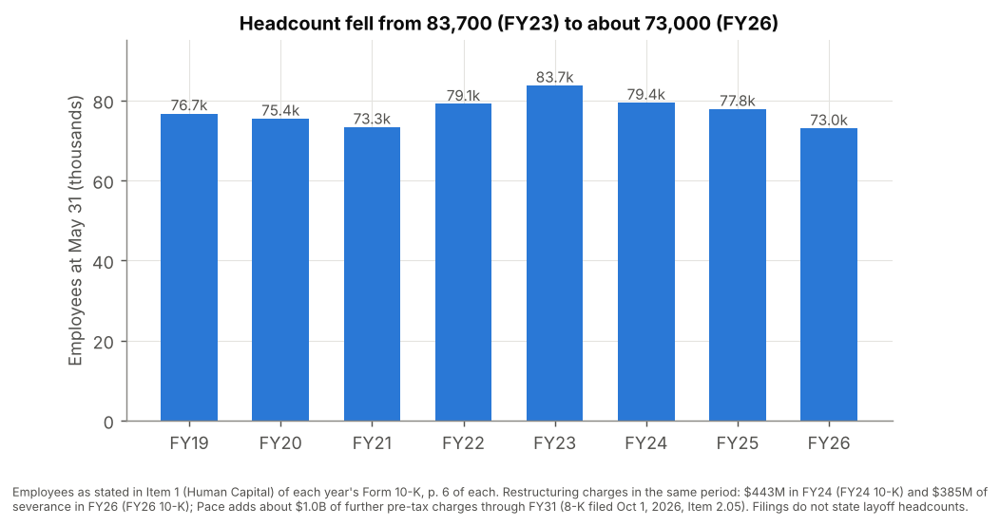

**Why Pace matters to a skeptical reader:** BNP Paribas called Pace "the third restructuring program since fiscal 2024" with "no operating leverage" from any so far (secondary: Retail Dive, Oct 2026). A turnaround that needs five more years of savings is a different investment from one that is nearly over.

---

## 5. The financials, with charts

### 5.1 Annual revenue and margin

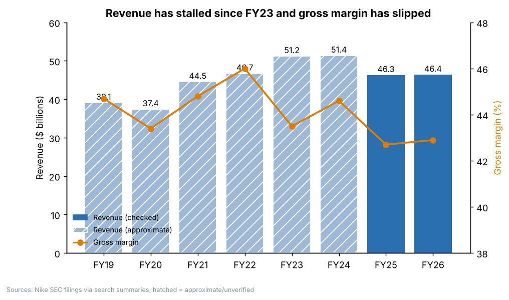

| | FY19 | FY20 | FY21 | FY22 | FY23 | FY24 | FY25 | FY26 |
|---|---|---|---|---|---|---|---|---|
| Revenue ($M) | 39,117 | 37,403 | 44,538 | 46,710 | 51,217 | 51,362 | 46,309 | 46,398 |
| Gross margin | 44.7% | 43.4% | 44.8% | 46.0% | 43.5% | 44.6% | 42.7% | 42.9% |
| Net income ($M) | 4,029 | 2,539 | 5,727 | 6,046 | 5,070 | 5,700 | 3,219 | 3,108 |
| Diluted EPS | $2.49 | $1.60 | $3.56 | $3.75 | $3.23 | $3.73 | $2.16 | $2.10 |

*Source: each year's own 10-K, income statement and MD&A: FY19 10-K pp. 22, 26, 50; FY20 pp. 25, 30; FY21 pp. 31, 57; FY22 pp. 31, 56; FY23 pp. 31, 55; FY24 pp. 33, 57; FY25 pp. 32, 56; FY26 pp. 32, 55.*

**What it shows:** revenue peaked in FY2024, dropped 10% in FY2025 and was flat in FY2026. Gross margin fell from 44.6% to 42.7% to 42.9%. FY2026's margin was held up by the tariff refund: Nike says the Q4 benefit "largely offsets the impact of the IEEPA tariffs recognized during fiscal 2026" (Q4 FY26 release pp. 4 to 5, footnote 2).

### 5.2 Earnings per share

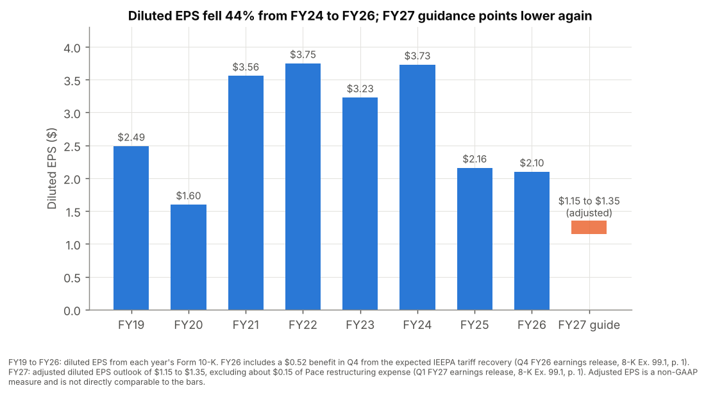

- EPS fell from **$3.73 (FY24) to $2.10 (FY26)**, a **44%** decline (my arithmetic).
- FY2026 EPS includes a **$0.52 per share** Q4 benefit from the expected recovery of IEEPA tariffs (Q4 FY26 release p. 1). Subtracting it gives $1.58 (my arithmetic). That is *not* a clean "underlying" figure, because the same year also bore the tariffs the refund offset.
- FY2027 guidance is **adjusted** EPS of $1.15 to $1.35, which "excludes approximately $0.15 of restructuring expenses related to Pace" (Q1 FY27 release p. 1). The midpoint, $1.25, is about 40% below FY2026's reported $2.10 (my arithmetic).

### 5.3 Quarterly view

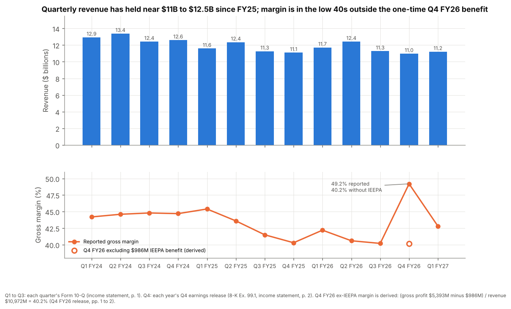

| Quarter | Revenue ($M) | Gross margin | Net income ($M) | Diluted EPS | Source |
|---|---|---|---|---|---|
| Q1 FY24 | 12,939 | 44.2% | 1,450 | $0.94 | Q1 FY24 10-Q p. 1 |
| Q2 FY24 | 13,388 | 44.6% | 1,578 | $1.03 | Q2 FY24 10-Q p. 1 |
| Q3 FY24 | 12,429 | 44.8% | 1,172 | $0.77 | Q3 FY24 10-Q p. 1 |
| Q4 FY24 | 12,606 | 44.7% | 1,500 | $0.99 | Q4 FY24 release p. 2 |
| Q1 FY25 | 11,589 | 45.4% | 1,051 | $0.70 | Q1 FY25 10-Q p. 1 |
| Q2 FY25 | 12,354 | 43.6% | 1,163 | $0.78 | Q2 FY25 10-Q p. 1 |
| Q3 FY25 | 11,269 | 41.5% | 794 | $0.54 | Q3 FY25 10-Q p. 1 |
| Q4 FY25 | 11,097 | 40.3% | 211 | $0.14 | Q4 FY25 release p. 2 |
| Q1 FY26 | 11,720 | 42.2% | 727 | $0.49 | Q1 FY26 10-Q p. 1 |
| Q2 FY26 | 12,427 | 40.6% | 792 | $0.53 | Q2 FY26 10-Q p. 1 |
| Q3 FY26 | 11,279 | 40.2% | 520 | $0.35 | Q3 FY26 10-Q p. 1 |
| Q4 FY26 | 10,972 | 49.2% | 1,069 | $0.72 | Q4 FY26 release p. 2 |
| Q1 FY27 | 11,213 | 42.8% | 712 | $0.48 | Q1 FY27 10-Q p. 1 |

*Gross margin percentages are from each filing's MD&A or release summary, on the same filing as the revenue.*

**Reading the chart:**
- Revenue has held between about $11.0 billion and $12.4 billion a quarter since FY2025, with no clear upturn.
- **Gross margin has fallen from the mid-44s to the low 40s.** The 49.2% in Q4 FY2026 included about 900 bps from the $986 million expected IEEPA refund (Q4 FY26 release p. 1). Without it, Q4 margin was about **40.2%**: gross profit of $5,393 million minus $986 million, divided by revenue of $10,972 million (my arithmetic on Q4 FY26 release p. 2).
- The 60 bps margin gain in Q1 FY2027 (to 42.8%) included about 90 bps from "lower warehousing and logistics costs" (Q1 FY27 10-Q pp. 19, 23). Cost-driven improvement like this can run out; price and demand improvement would be stronger evidence.

**About the tariff refund.** On February 20, 2026 the U.S. Supreme Court ruled the IEEPA tariffs unauthorized. As of April 1, 2026 Nike had paid about $1.0 billion of them and judged recovery "not probable" (Q3 FY26 10-Q p. 26). In Q4 it deemed recovery "probable" and booked $986 million: $965 million in North America and $21 million in Converse (FY26 10-K p. 30; Q4 FY26 release pp. 4 to 5). About $0.3 billion was received in FY2026 (Q4 FY26 release p. 1). The rest was collected in Q1 FY2027, which is why receivables fell from $5,931 million to $5,242 million (Q1 FY27 10-Q p. 3).

### 5.4 Where revenue is shrinking

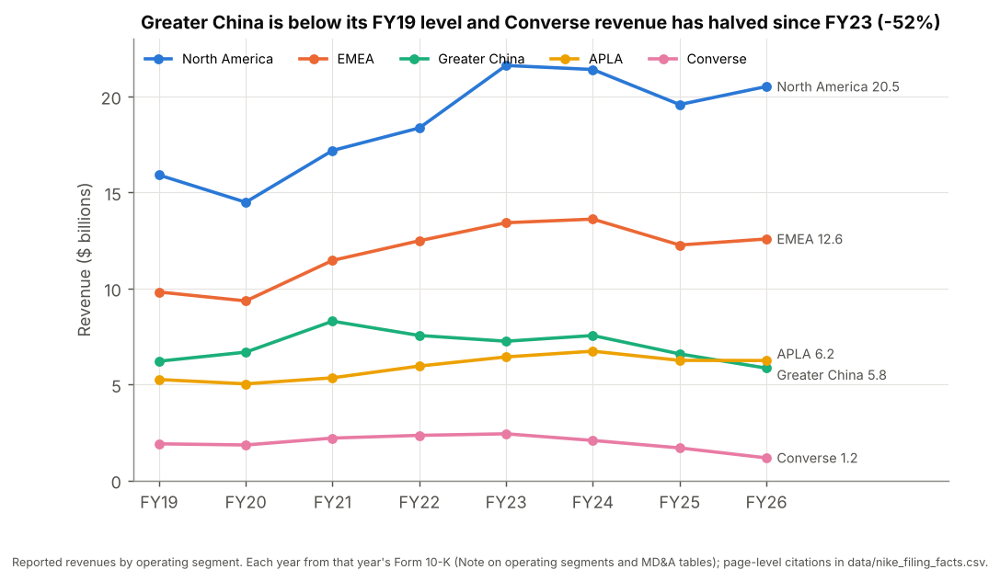

| Segment ($M) | FY19 | FY20 | FY21 | FY22 | FY23 | FY24 | FY25 | FY26 |
|---|---|---|---|---|---|---|---|---|
| North America | 15,902 | 14,484 | 17,179 | 18,353 | 21,608 | 21,396 | 19,572 | 20,511 |
| EMEA | 9,812 | 9,347 | 11,456 | 12,479 | 13,418 | 13,607 | 12,257 | 12,572 |
| Greater China | 6,208 | 6,679 | 8,290 | 7,547 | 7,248 | 7,545 | 6,586 | 5,847 |
| APLA | 5,254 | 5,028 | 5,343 | 5,955 | 6,431 | 6,729 | 6,251 | 6,243 |
| Converse | 1,906 | 1,846 | 2,205 | 2,346 | 2,427 | 2,082 | 1,692 | 1,174 |

*Source: each year's 10-K segment tables: FY19 p. 27; FY20 p. 31; FY21 p. 36; FY22 p. 36; FY23 p. 32; FY24 p. 38; FY25 p. 33; FY26 p. 32.*

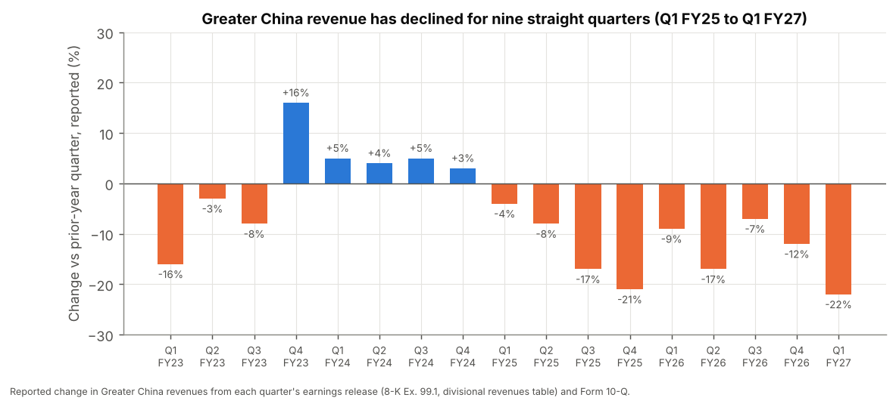

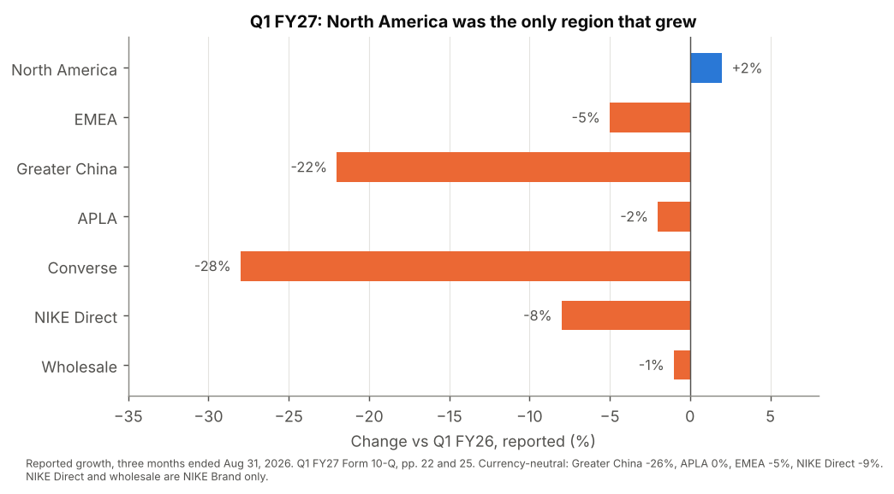

- **Greater China** revenue fell **22%** in Q1 FY2027 (26% currency-neutral) to $1,180 million, and its EBIT fell 34% to $248 million (Q1 FY27 10-Q p. 25). It has now declined for **nine consecutive quarters**, from Q1 FY2025 to Q1 FY2027 (quarterly releases and 10-Qs; chart 12). FY2026 Greater China revenue of $5,847 million was below FY2019's $6,208 million.
- Nike's outlook: "The actions related to Converse are expected to continue throughout fiscal 2027 and for Greater China to extend beyond fiscal 2027" (Q1 FY27 10-Q p. 20). From January 2027 Nike plans to sell online in China only through its own app and site plus official Tmall, JD.com and Douyin stores (secondary: Just Style, July 2026).
- **Converse** fell 28% in Q1 FY2027 to $263 million (Q1 FY27 10-Q p. 25), after falling 32% in Q4 FY2026 (Q4 FY26 release p. 4) and 31% for FY2026 (FY26 10-K p. 32). Revenue has more than halved since FY2023 ($2,427 million to $1,174 million).
- **North America was the only region that grew** in Q1 FY2027, up 2% to $5,127 million (Q1 FY27 10-Q p. 25). EMEA fell 5% and APLA fell 2% reported (flat currency-neutral, which settles the conflict in the previous draft).

### 5.5 Channel mix: the direct-to-consumer reversal

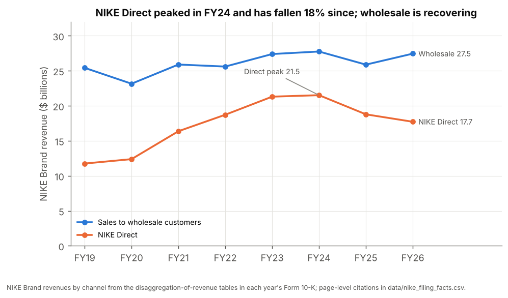

- NIKE Direct revenue peaked at **$21,519 million in FY2024** (FY24 10-K p. 34) and was **$17,720 million in FY2026** (FY26 10-K p. 32), down 18% (my arithmetic). Sales to wholesale customers rose to $27,453 million in FY2026 (FY26 10-K p. 32).
- In Q1 FY2027, NIKE Direct fell 8% to $4,142 million and wholesale fell 1% to $6,804 million (Q1 FY27 10-Q p. 22). Within NIKE Direct, NIKE Brand Digital fell 13% and Nike-owned stores fell 5% (Q1 FY27 release p. 1).

### 5.6 Balance sheet and cash

| Item ($M) | May 31, 2026 | Aug 31, 2026 | Source |
|---|---|---|---|
| Cash and equivalents | 7,563 | 6,903 | FY26 10-K p. 57; Q1 FY27 10-Q p. 3 |
| Short-term investments | 1,464 | 1,465 | same |
| Inventories | 7,501 | 7,846 | same |
| Current portion of long-term debt | 2,000 | 2,000 | same |
| Long-term debt | 5,942 | 5,893 | same |
| Shareholders' equity | 14,865 | 15,220 | same |

My arithmetic: cash plus short-term investments of $8,368 million at Aug 31, 2026 slightly exceeds total debt of $7,893 million (the balance sheet shows no notes payable). Inventories were down 3% from a year earlier ($8,114 million at Aug 31, 2025; Q1 FY26 10-Q p. 3) but up about 5% since May 31 while sales fell. That is worth watching, because excess inventory forces discounting and hurts margin.

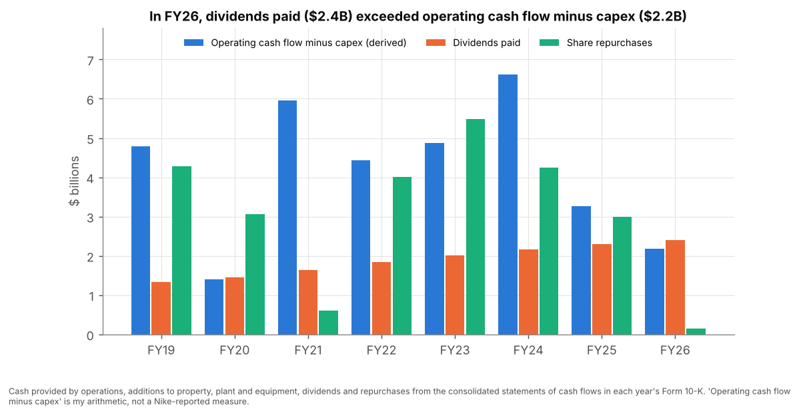

**Cash flow.** FY2026 cash from operations was $2,868 million and capital expenditure $684 million, while dividends paid were $2,407 million and buybacks only $146 million (FY26 10-K p. 58). Cash from operations minus capex was $2,184 million, less than the dividend (my arithmetic). In FY2024 the same measure was $6,617 million (FY24 10-K p. 60; my arithmetic).

### 5.7 Profit by region: the ranking has flipped

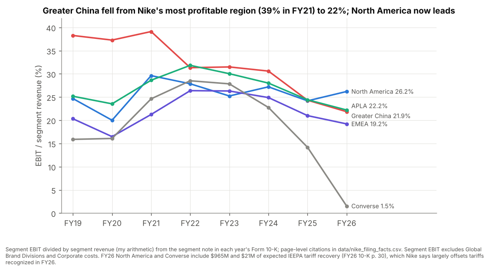

Segment EBIT divided by segment revenue (my arithmetic on the segment note of each 10-K; full citations in `data/nike_region_profitability.csv`):

| Segment | FY2019 | FY2021 | FY2024 | FY2026 | Q1 FY2026 | Q1 FY2027 |
|---|---|---|---|---|---|---|
| North America | 24.7% | 29.6% | 27.2% | 26.2% (21.5% ex refund) | 22.6% | 22.8% |
| EMEA | 20.3% | 21.3% | 24.9% | 19.2% | 22.1% | 22.9% |
| Greater China | 38.3% | 39.1% | 30.6% | 21.9% | 24.9% | 21.0% |
| APLA | 25.2% | 28.6% | 28.0% | 22.2% | 23.5% | 22.1% |
| Converse | 15.9% | 24.6% | 22.8% | 1.5% | 10.7% | 9.5% |

| Segment gross margin | FY2023 | FY2024 | FY2025 | FY2026 | Source |
|---|---|---|---|---|---|
| North America | 42.2% | 44.4% | 43.5% | 45.6% | FY25 10-K p. 38; FY26 10-K p. 37 |
| EMEA | 45.3% | 44.2% | 43.2% | 41.8% | FY25 10-K p. 39; FY26 10-K p. 38 |
| Greater China | 51.0% | 50.2% | 46.0% | 45.7% | FY25 10-K p. 40; FY26 10-K p. 39 |
| APLA | 48.1% | 45.9% | 44.0% | 42.0% | FY25 10-K p. 41; FY26 10-K p. 40 |
| Converse | 53.8% | 52.5% | 48.7% | 43.8% | FY25 10-K p. 42; FY26 10-K p. 41 |

- **Change in EBIT, FY2024 to FY2026, by segment** (FY24 and FY26 10-Ks; my arithmetic):

  | Segment | Change in EBIT |
  |---|---|
  | Greater China | -$1,031 million |
  | EMEA | -$971 million |
  | APLA | -$498 million |
  | Converse | -$456 million |
  | North America, reported | -$446 million |
  | North America, excluding the $965 million IEEPA refund booked there (FY26 10-K p. 30) | -$1,411 million |

  Nike says the refund "largely offsets the impact of the IEEPA tariffs recognized during fiscal 2026" (Q4 FY26 release pp. 4 to 5), so the reported figure is the no-tariff view and the ex-refund figure is the with-tariff view.
- **Sensitivity:** if Greater China's EBIT margin returned to its FY2024 level of 30.6% on FY2026 revenue, segment EBIT would be about **$511 million higher**, 13% of FY2026 total EBIT of $3,850 million (my arithmetic).
- **North America is the only segment whose FY2026 gross margin is above FY2023, but only because of the tariff refund.** Including the $965 million IEEPA refund it was 45.6%; excluding it, 40.9%, below FY2023's 42.2% (my arithmetic; `research_notes/15_why_nike_discounts.md` row 5d). It is also the segment that moved furthest toward wholesale: its Direct share fell from 48.6% to 41.7% between FY2024 and FY2026 (FY24 10-K p. 84; FY26 10-K p. 83). Its gross margin gain did not reach EBIT on a with-tariff basis (27.2% to 21.5%). The divergence is the refund, not pricing (row 5d of `research_notes/15_why_nike_discounts.md`).
- **Higher Direct share does not line up with better margins across regions.** In FY2026 the two most Direct-heavy segments, Greater China (44.3%) and Converse (44.1%), had the steepest profit declines.
- Detail: `research_notes/06_region_margin_product.md`.

### 5.8 Does selling direct pay? Testing it with Nike's own numbers and peers

Nike does not report profit by channel. Four indirect tests (detail and every source in `research_notes/09_channel_margin_test.md` and `10_peer_channel_margins.md`):

1. **What Direct earns above a wholesale sale.** Until FY2024 Nike disclosed internal sales to NIKE Direct "charged at prices comparable to those charged to external wholesale customers" (FY24 10-K p. 32).
   - NIKE Direct revenue was 1.62x to 1.66x that internal cost from FY2017 to FY2021.
   - It reached **1.78x in FY2022**, a year of low promotions and tight supply, then fell to 1.67x in FY2023 and 1.65x in FY2024 (my arithmetic on FY19 to FY24 10-Ks).
   - In FY2024 the spread was $8.5 billion, or 39.5% of Direct revenue.
   - FY2022 is partly flattered by inventory timing, but the FY2022 to FY2023 average (1.72x) is still above the years before and after.
2. **Nike's gross margin bridge isolates Direct.**
   - "Margin in our NIKE Direct business" added **+160 bps** to company gross margin in the first nine months of FY2022, on "lower promotional activity" (Q3 FY22 10-Q p. 30).
   - It subtracted **-130 bps** in the first nine months of FY2023, on "higher promotional activity to liquidate inventory" (Q3 FY23 10-Q p. 29), and -40 bps in FY2024 (FY24 10-K p. 36).
   - That is about +$552 million, then -$499 million, then -$205 million of gross profit (my arithmetic). Full-price list prices were rising at the same time (+200 to +410 bps per quarter in FY2023).
3. **Peers at gross margin.** Skechers, the only peer reporting gross margin by channel, earned 16.7 to 29.6 points more in DTC than in wholesale every year from FY2019 to H1 2025 (66.2% vs 43.3% in FY2024; Skechers FY24 10-K p. 47). With one stated assumption (a Nike wholesale gross margin of 35% to 45%), Nike's own data implies a similar gap of 21.7 to 25.7 points (my arithmetic).
4. **Peers at operating margin.**
   - Deckers (UGG, HOKA) reported segment operating income with transfers to DTC at cost. Its DTC segment earned **3.8 to 5.0 points less** than wholesale in FY2018 to FY2020, then 2.2 to 10.1 points more in FY2021 to FY2024 (Deckers FY20 10-K p. F-41; FY24 10-K p. F-38; my arithmetic).
   - Deckers credits "less discounting and promotional activity" and store closures for the turn (FY19 10-K pp. 39 to 40).
   - Foot Locker, the retailer that keeps the shelf margin on a wholesale sale, earned a gross margin of 27.7% to 34.4% from 2019 to 2024.

**Verdict.**
- **Gross margin:** selling direct keeps a large gross margin lead even through discount cycles.
- **Operating level:** Direct beats wholesale only while its spread over wholesale exceeds its own store and fulfilment costs, and promotions use up that cushion.
- **Break-even (assumption: Nike's Direct cost to serve, as a share of revenue, is close to Foot Locker's gross margin):** the cushion runs out at an average Direct markdown of roughly **8% to 16%** (my arithmetic).
- **Unknown:** Nike does not disclose markdown depth, so whether Direct was below break-even in FY2025 and FY2026 is the open question (Section 12).
- **From FY2025, Nike's bridge shows the trade directly.** A wholesale sale lowers ASP but cuts "warehousing and logistics costs ... primarily due to channel mix" (+20 bps in FY2026, FY26 10-K p. 34; +90 bps in Q1 FY2027 against a -30 bps ASP effect, Q1 FY27 10-Q p. 23).

### 5.9 Converse: a decline driven by unit volume, now a deliberate reset

| | FY2023 | FY2024 | FY2025 | FY2026 | Q1 FY2027 |
|---|---|---|---|---|---|
| Revenue ($M) | 2,427 | 2,082 | 1,692 | 1,174 | 263 (-28%) |
| Units sold, change | n/a | -12% | -12% | -31% | -34% |
| Gross margin | 53.8% | 52.5% | 48.7% | 43.8% | 45.2% |
| EBIT ($M) | 676 | 474 | 240 | 18 | 25 |
| U.S. Converse stores (May 31) | 82 | 81 | 78 | 60 | n/a |

Sources:
- Revenue and EBIT: FY23 to FY26 10-K segment tables; Q1 FY27 10-Q p. 25.
- Units: FY24 10-K p. 43; FY25 10-K p. 43; FY26 10-K p. 42; Q1 FY27 10-Q p. 31.
- Gross margin: FY25 10-K p. 42; FY26 10-K p. 41; Q1 FY27 10-Q p. 30.
- U.S. stores: 10-Ks pp. 2 to 3.

**The bridge (my arithmetic):**
- **About 85% of the $1,253 million revenue decline is volume.** Units fell to a cumulative index of about 0.53, and price to about 0.90.
- **Gross profit fell about $792 million:**
  - about $674 million from lost volume;
  - about $117 million from the 10-point margin decline, which Nike attributes to "higher discounts" in FY2024 and FY2025, and to discounts plus "inventory obsolescence reserves and employee severance costs" in FY2026 (FY26 10-K p. 42).
- **Costs below gross profit fell only 21% against a 52% revenue decline**, rising from 25.9% to 42.3% of revenue. That deleverage took EBIT from $676 million to $18 million, or about -$3 million excluding a $21 million tariff refund (FY26 10-K p. 30).

**Phases and management statements:**
- **Where the decline started.** FY2024 declines were "in North America and Western Europe" (FY24 10-K p. 43); from FY2025 they were in "all territories."
- **The reset.** Since Q2 FY2026, "Converse is in the midst of a strategic reset of the brand and marketplace" (FY26 10-K p. 30). Brand marketing was cut 39% in FY2026 and 58% in Q1 FY2027 (FY26 10-K p. 42; Q1 FY27 10-Q p. 31), and actions "are expected to continue throughout fiscal 2027" (Q1 FY27 10-Q p. 20).
- **First price gain.** Q1 FY2027 is the first period in this run where price rose ("higher ASP contributed approximately 6 percentage points ... product mix and lower discounts," Q1 FY27 10-Q p. 31).
- **Leadership.** Aaron Cain replaced Jared Carver as CEO in July 2025 (secondary: Retail Dive, Jul 11, 2025).
- **Sale interest.** Authentic Brands Group reportedly expressed interest in buying Converse "if it's put up for sale"; Hill said "we're committed to the Converse brand" (secondary: Boston Globe, Mar 31, 2026).

**What the filings cannot separate:** how much of the FY2026 unit decline was supply Nike withheld during the reset, and how much was lower retail sell-through.

**Fix-or-exit arithmetic:** at FY2026 costs below gross profit (about $496 million), returning to FY2024 EBIT of $474 million needs about $1.80 billion of revenue at FY2023 gross margin, or about $2.21 billion at FY2026 gross margin. That is 54% to 89% above FY2026 revenue (my arithmetic).

Detail: `research_notes/06_region_margin_product.md` Section 5 and `08_converse_detail.md`.

### 5.10 Product: what is new, what is being cut, and where it is sold

| | FY2024 | FY2026 | Change | Q1 FY2027 vs Q1 FY2026 |
|---|---|---|---|---|
| Footwear ($M) | 33,427 | 29,525 | -11.7% | -6.2% |
| Apparel ($M) | 13,775 | 13,449 | -2.4% | +2.1% |
| Equipment ($M) | 2,075 | 2,199 | +6.0% | -3.0% |

Sources: FY24 10-K p. 34; FY26 10-K p. 32; Q1 FY27 10-Q p. 22. Changes are my arithmetic.

The revenue decline is concentrated in footwear. On the cut side, Nike "reduced revenue from the Dunk by nearly 50% in the quarter," a roughly $200 million headwind, and is reducing Jordan retro launches (Q1 FY27 call remarks). The 10-Q says NIKE Sportswear and Jordan actions "are expected to extend beyond fiscal 2027" (Q1 FY27 10-Q p. 20).

New product, as described by Nike management. These are company statements, not reported revenue:
- **Running is the lead category.**
  - The Vomero 18 became "a $100 million dollar plus franchise" in about 90 days (Q4 FY25 call).
  - Running posted "five consecutive quarters of double-digit growth" (Q1 FY27 call).
- **Women's basketball and new platforms:**
  - The Caitlin 1 is "the largest women's signature shoe launch in Nike's history" (Q1 FY27 call).
  - Nike Mind "sold out in all geographies" (Q3 FY26 call).
- **Wholesale-first launches:**
  - Structure Plus launched "exclusively at running specialty stores worldwide" four weeks before nike.com (Nike release).
  - Vomero Premium reached "select retail partners" two weeks before its global release (Nike release).
- **New and partner-specific wholesale:**
  - A brand store on Amazon in the U.S. from fall 2025.
  - Dick's (24.7 training) and JD (Air Max 95) were named as partnership examples (Q4 FY25 call).
- **China first:** LeBron XXIII, Nike Hybrid RN and Caitlin 1 released in China one to two weeks before their global dates (Nike releases).
- **Channel strategy, in Nike's words:** "For years, we were running a Nike direct-first offense. Now, we are rebalancing our offense through an integrated, elevated marketplace" (Q3 FY26 call).

The full list of 40 launches, with channel, geography and sources, is in `research_notes/07_new_products_detail.md`.

**Wholesale is getting more concentrated.** Nike's top three U.S. customers rose from 21% of U.S. sales in FY2024 to 29% in FY2026 (FY24 and FY26 10-Ks pp. 2 to 3). Nike's share of Foot Locker's purchases fell from 75% (2020) to 59% (2024), while its share of Dick's purchases rose from 17% (FY2021) to 25% (FY2024) (retailer 10-Ks; `research_notes/10_peer_channel_margins.md`).

### 5.11 Revenue streams: is there anything beyond DTC and wholesale?

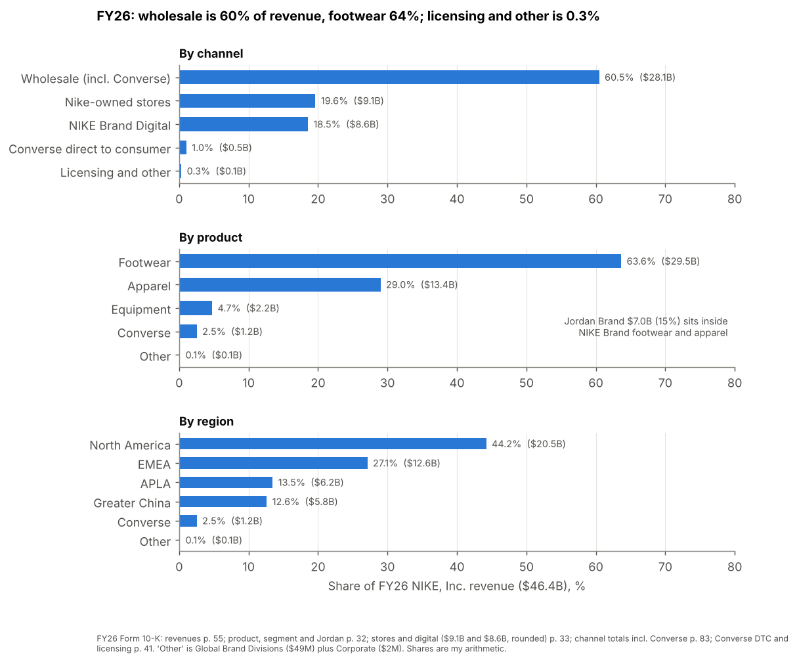

- **No.** In FY2026, 99.7% of NIKE, Inc. revenue ($46,398 million, FY26 10-K p. 55) was product sold to retailers or directly to consumers. Licensing and other income was $143 million, or 0.3% (FY26 10-K p. 83; my arithmetic). Nike has no royalty or services income of any size to cushion a product downturn.
- **By channel:** wholesale including Converse $28,058 million (60.5%) and NIKE Direct including Converse $18,197 million (39.2%) (FY26 10-K p. 83). Within NIKE Brand Direct, Nike-owned stores were $9.1 billion and NIKE Brand Digital $8.6 billion (FY26 10-K p. 33).
- **By product:** footwear $29,525 million (63.6%), apparel $13,449 million (29.0%), equipment $2,199 million (4.7%) and Converse $1,174 million (2.5%) (FY26 10-K p. 32; shares my arithmetic). Equipment is the only line that grew from FY2024 to FY2026.
- **By region:** North America 44.2%, EMEA 27.1%, APLA 13.5%, Greater China 12.6% (FY26 10-K p. 36; my arithmetic).
- **By brand:** Jordan Brand, at $7,034 million, is about 15% of revenue and sits inside the NIKE Brand footwear and apparel lines (FY26 10-K p. 32). It is the only sub-brand Nike discloses. Full tables: `research_notes/11_revenue_streams.md`.

### 5.12 Jordan Brand: oversupply, then a supply cut that has not yet worked

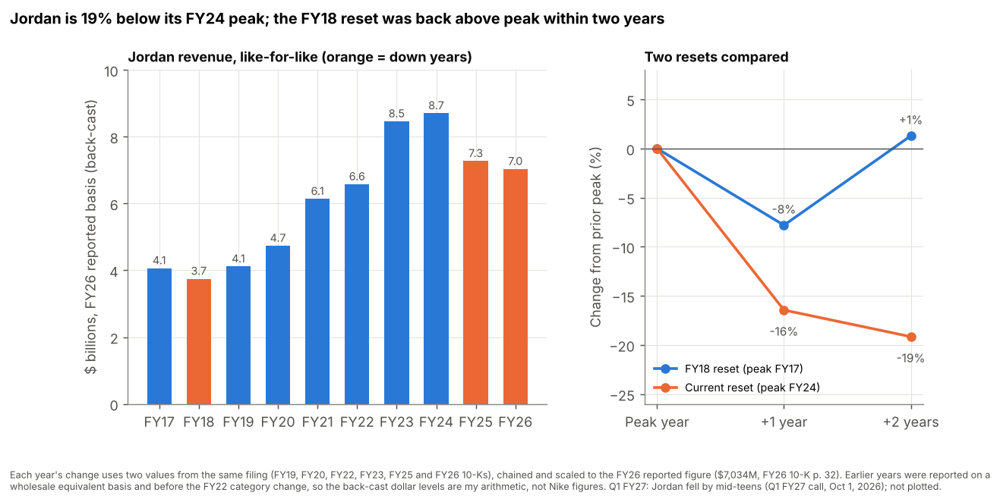

**The number most readers have wrong.** Until FY2024, Nike reported Jordan on a *wholesale equivalent* basis, which valued Jordan sold through NIKE Direct at an internal wholesale price. From Q1 FY2025 Nike "removed the non-GAAP financial measure of wholesale equivalent revenues" (Q1 FY25 10-Q p. 19) and recast prior years (FY25 10-K p. 33). FY2024 Jordan moved from $6,988 million (FY24 10-K p. 34) to $8,701 million. Comparing the old FY2024 figure with the new FY2025 figure ($7,270 million) shows growth of 4%; the filed change is **-16%**.

| Fiscal year | Jordan revenue ($M, reported basis) | Change | Source |
|---|---|---|---|
| FY2023 | 8,460 | | FY25 10-K p. 33 |
| FY2024 | 8,701 | +3% | FY26 10-K p. 32 |
| FY2025 | 7,270 | -16% | FY26 10-K p. 32 |
| FY2026 | 7,034 | -3% | FY26 10-K p. 32 |
| Q1 FY2027 | 13% of Nike revenue | "falling by mid-teens" | Nike transcript, Q1 FY27 call |

- Jordan is **19% below its FY2024 peak** (my arithmetic). If all of FY2027 fell mid-teens, Jordan would be about $6.0 billion, roughly 31% below peak (my arithmetic, illustrative; Nike gives no Jordan guidance).
- **The precedent.** "Back in Fiscal 18, we recalibrated the supply of select Jordan Brand franchises ... we turned the page from double-digit declines in the Brand to the start of multiple consecutive years of strong double-digit growth" (Nike transcript, Q4 FY24 call). Jordan fell 8% in FY2018 (FY19 10-K p. 27), was back above its FY2017 level within two years, and was about 2.3 times its FY2018 low by FY2024 (chained same-filing growth rates; my arithmetic, chart 17).
- **The same play now, stated outright:** "we've been oversupplying our iconic retro product ... as we've done with the Air Jordan 1, we will deliberately reduce the volume and frequency of specific Jordan Retro launches ... In the near term, North America will feel the biggest impact" (Nike transcript, Q1 FY27 call, Oct 1, 2026). Nike says Jordan and Sportswear actions "are expected to extend beyond fiscal 2027," reflecting "higher levels of discounting and broader marketplace pressure" (Q1 FY27 10-Q p. 20).
- **New estimate: Jordan is Nike's most DTC-dependent franchise (my inference).** The restatement swapped internal transfer prices for actual NIKE Direct revenue. Across NIKE Brand in FY2024, internal sales to NIKE Direct were $13,009 million against NIKE Direct revenue of $21,519 million (FY24 10-K p. 34), an internal price of about 60.5% of retail. Jordan's FY2024 restatement gap of $1,713 million then implies Jordan Direct revenue of about $4.3 billion, **about 50% of Jordan revenue**, against 43.6% for NIKE Brand (my arithmetic; range 45% to 55% under different price assumptions). Jordan accounted for 20% of the restatement gap but 17.6% of NIKE Brand revenue. The Jordan decline and the 32% fall in NIKE Brand Digital since FY2023 (`research_notes/05_channel_split.md` Section 2) are largely one story: retro launches drove the app.

**The evidence test (October 13, 2026).** We tested the scarcity claim ten ways from primary documents and data we could open (`research_notes/12_jordan_brand_thesis.md` Section 5; extracts in `research_notes/jordan_extracts/rabbit_hole/`).

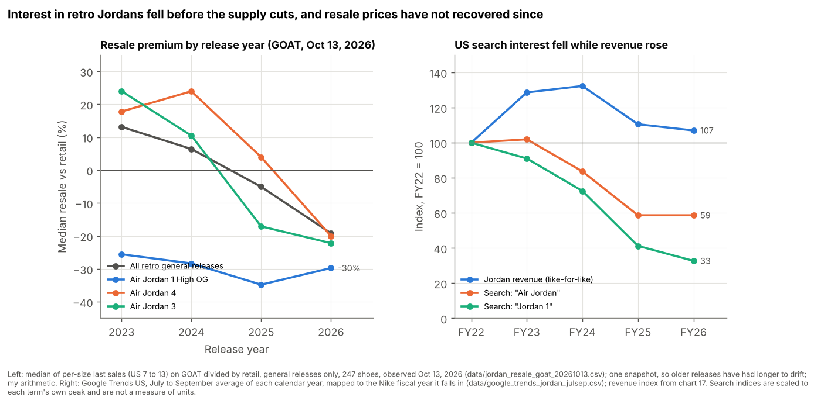

- **Ruled out:** a market or category decline (US footwear flat in 2025 per Circana, secondary; Nike North America footwear units +6% in FY2026, FY26 10-K), accounting and currency. Jordan fell 19.2% from FY2024 to FY2026 against 6.0% for the rest of NIKE Brand; about 13 points are Jordan-specific (my arithmetic).
- **The cut was planned:** "The Jordan brand was planned down double digits this quarter, and we expect Jordan to be down at the same rate for fiscal '25" (Nike transcript, Q1 FY25 call). FY2025 came in at -16%.
- **But demand fell first:** US search interest in "Jordan 1" fell 59% and "Air Jordan" 41% from July to September 2021 to the same months of 2024, while Jordan revenue rose 32% from FY2022 to FY2024 (Google Trends; my arithmetic). Weekly US SNKRS app downloads fell from 101K to 32K in Q2 2023 (Sensor Tower, secondary).
- **The first cut has not restored pricing:** median GOAT resale premiums for Air Jordan 1 High OG general releases are -26% (2023 releases), -28%, -35% and -30% (2026 releases); 40 of 41 trade below retail. Volume moved to other models: Air Jordan 4 releases rose from 7 (2023) to 33 (2025) and its premium fell from +24% (2024 releases) to -20% (2026 releases) (Sole Retriever archive; GOAT, Oct 13, 2026; my arithmetic). Total retro release counts did not fall: 98, 96, 113 and about 91 a year from 2023 to 2026.
- **Retailers saw the turn:** Foot Locker reported retro "sellouts" in Q4 2024, then "lower demand of key basketball footwear styles" in mid-2025; in May to July 2026 DICK'S said Foot Locker had "fewer launches" that "performed below both industry and our expectations" (retailer filings and calls).
- **Verdict (my inference):** Nike oversupplied retro Jordans, demand reset, and Nike is cutting supply in response. The broad retro cut announced October 1, 2026 has not yet reached the shelf; the press expects it in 2027. Nike discloses no Jordan units, price or inventory, so the supply and demand split (roughly 35% to 50% supply, 50% to 65% demand) is an estimate.
- **Timing:** the FY2018 reset took about 2 quarters to clean inventory and 4 to 5 to return to growth. Applied to October 2026, and given that management says pressure will "bleed in a little bit into fiscal '28" (Nike transcript, Q1 FY27 call), Jordan growth is unlikely before FY2028.

**Direct tests (Section 5.13):** Nike holds Jordan retro list prices on nike.com while Foot Locker discounts 2026 retros 18% to 23% and pre-cut retros sit in full size runs weeks after launch. **What will settle it:** whether the holiday 2026 retros (AJ4 Bred, AJ11 Space Jam, AJ12 Fireside) trade above retail on GOAT and StockX; any Jordan units, price or inventory disclosure at Investor Day (Nov 16 to 17, 2026); whether Jordan's mid-teens decline narrows on the Q2 FY2027 call. Full analysis, sources and verification status: `research_notes/12_jordan_brand_thesis.md` and `research_notes/jordan_extracts/`.

**What Jordan is worth (illustrative scenario valuation).**

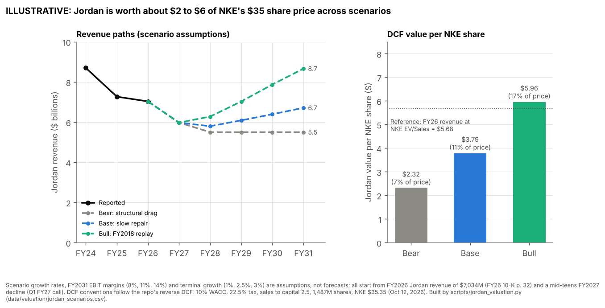

Nike discloses no Jordan profit, so this is a scenario DCF with labelled assumptions. It uses the same conventions as the repo's reverse DCF: 10% WACC, 22.5% tax, 1,487M shares and NKE at $35.35. Every scenario starts from FY2026 revenue of $7,034M (FY26 10-K p. 32) and a -15% FY2027 (Q1 FY27 call: "falling by mid-teens"). Full method and sensitivity: `research_notes/13_jordan_valuation.md`.

| Scenario (assumptions) | FY2031 revenue | FY2031 EBIT margin | FY2031 EPS contribution | Value per NKE share | Share of price |
|---|---|---|---|---|---|
| Bear: no recovery, flat from FY2029 | $5.5B | 8% | $0.23 | $2.32 | 7% |
| Base: +5% a year from FY2029 | $6.7B | 11% | $0.39 | $3.79 | 11% |
| Bull: FY2018 replay, back to the FY2024 peak by FY2031 | $8.7B | 14% | $0.63 | $5.96 | 17% |

- **Jordan is about a 10% lever on the stock.** The bull-to-bear spread is $3.64 a share. In earnings terms the spread is about $0.40 of FY2031 EPS, roughly a third of the FY2027 adjusted EPS guidance midpoint of $1.25 (my arithmetic).
- **The market already pays close to the bull case (my inference).** Jordan's FY2026 revenue at NKE's own EV/Sales of about 1.2x is worth $5.68 a share, near the bull DCF. That is because NKE's multiple already embeds a return to 12% to 14% margins. On these assumptions Jordan is mainly a downside risk of about $1.90 to $3.40 a share (bull-equivalent $5.68 less the base $3.79 or bear $2.32), unless it beats the bull case.
- **Margin matters more than volume.** On the base revenue path, moving from an 8% to a 14% margin adds $1.99 a share. Moving from the bear to the bull revenue path at an 11% margin adds $1.57. Fewer pairs sold at full price can be worth more than more pairs sold at a discount.

### 5.13 Five definitive tests: is the supply cut restoring full-price selling?

Earlier evidence in this report leans on what Nike says and on proxies such as review tone, which came back inconclusive (`research_notes/thesis_tests/review_tone_jin2023.md`). These five tests measure the quantities that decide the question directly: pairs made and sold, price, stock left on the shelf and time to markdown. Each uses a comparison group, and each states in advance what result would prove the "deliberate supply cut, full price returning" story wrong. Full method, tables and source URLs: `DEEP_DIVE_DEFINITIVE_TESTS.md`; data in `data/definitive/`; scripts in `scripts/definitive/`.

| Test | What it measures | Result | Verdict on the thesis |
|---|---|---|---|
| 1. Factory orders | Monthly revenue of Nike's footwear factories, 2013 to Sep 2026 | Feng Tay revenue fell 10% to 23% a year from Dec 2022 to Nov 2023 while Nike footwear grew; in FY2025 Nike footwear fell 11.7%, Feng Tay only 4.7% | No factory cut matches the FY2025 decline; the 2023 cut was inventory correction |
| 2. Time to markdown | Days until each release is first discounted, nike.com and Foot Locker | No Air Jordan 1 High, 3 or 4 release from 2024 to 2026 seen discounted on nike.com within 90 days; running controls mark down from about day 50; Foot Locker already discounts 2026 retros | Nike holds list price; markdowns move to its retailers |
| 3. Size runs after launch | Which sizes are still in stock at nike.com, Foot Locker and Champs | Pre-cut retros in full size runs at full price four to ten weeks after launch | Oversupply on the shelf; post-cut releases decided by re-runs on Oct 24 and Nov 7 |
| 4. Resale over time | Same shoes re-priced over time, Air Jordan 1 High (cut) vs Air Jordan 3 (raised) | Air Jordan 1 did 22.7 points worse after its cut (95% interval -48.3 to +3.5) | Directional against "scarcity works"; not decided, Air Jordan 4 control still being collected |
| 5. Units vs price | All 694 unit and price statements in Nike's 10-Ks and 10-Qs since FY2017 | Only Greater China and Converse show fewer pairs at steady prices; North America sells more pairs at lower prices | The deliberate-cut pattern is absent where the Jordan cut is aimed |

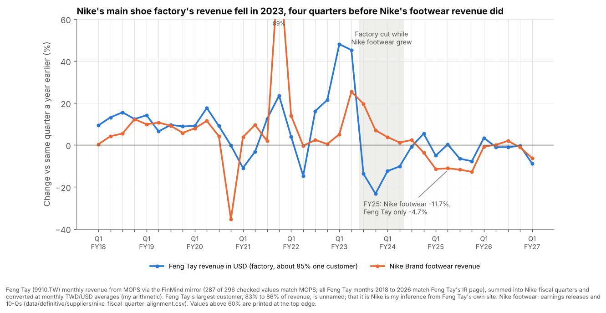

**Key findings.**
- **Nike's list price on Jordan retros is not evidence of demand.** On nike.com, 2 of 113 listed colourways in the main Jordan retro lines are discounted, against 22 of 22 Pegasus 41 colourways from 2024 (api.nike.com product feed, Oct 13, 2026; my arithmetic). The Air Jordan 1 High OG "Midnight Navy" is still listed at its full $180, 759 days after release. Yet:
  - Pre-cut retros sit in every size weeks after launch (Test 3).
  - Air Jordan 1 High general releases trade 26% to 35% below retail on resale (Section 5.12).
  - Foot Locker discounts the same shoes: the 2026 Air Jordan 3 IF4396-100 is at $169.99 against a $215 list, 21% off (footlocker.com, Oct 13, 2026).

  The markdown for unsold retros happens in Nike's wholesale channel and in resale, not on nike.com (my inference).
- **The factory data date the big supply cut to 2023, not FY2025.**
  - Feng Tay's single largest customer, 83% to 86% of its revenue and in my inference Nike, took NT$73.0 billion in 2023 against NT$81.6 billion in 2022, down 10.5% (Feng Tay 2023 financial report, major-customer note; my arithmetic). Nike footwear rose 0.9% in FY2024 (June 2023 to May 2024, overlapping most of that year).
  - In FY2025, when Nike footwear fell 11.7%, Feng Tay fell only 4.7% (chart 20).
  - Feng Tay's revenue growth also leads Nike footwear growth by about one quarter (correlation 0.68 excluding FY2020 to FY2022). Its Q1 FY2027 reading of -8.8% points to continued footwear weakness in Q2.
- **Nike's own filings show the supply-cut pattern only where Nike is shrinking.** Greater China: "Unit sales of footwear decreased 26%, while ASP per pair was flat as lower discounts were offset primarily by channel mix" (Q1 FY27 10-Q p. 28). North America sold 2% more footwear pairs at lower ASP in the same quarter (Q1 FY27 10-Q p. 26).
- **The FY2018 reset began with discounting, not a supply cut.** "Unit sales of footwear for the first quarter of fiscal 2018 were flat, while lower ASP per pair reduced footwear revenues by approximately 3 percentage points primarily due to lower full-price ASP, driven by product mix and higher discounts" (North America, Q1 FY18 10-Q p. 26). This changes how the FY2018 analog in Section 5.12 should be used.

**What this means for the thesis (my inference).**
- The tests do not support "a deliberate supply cut is restoring full-price selling" for North America and Jordan, which is the recovery the share price needs (Section 6).
- They fit the underweight framing: the price assumes a return to roughly FY2024 margins, while direct measures show unsold Jordan retros being discounted at retail, no factory cut matching the FY2025 decline, and North America still selling more pairs at lower prices.
- **What would change the verdict:**
  - Post-cut retros (Air Jordan 1 Royal, Air Jordan 12 Fireside, Air Jordan 4 Bred, Air Jordan 11 Space Jam) selling through their core sizes within two to four weeks.
  - Retailer discounts on 2026 retros disappearing.
  - North America footwear units falling with ASP rising in the Q2 FY2027 10-Q.
  - Feng Tay's monthly revenue turning up ahead of Nike.

---

## 6. The stock: price, valuation, dividend, analysts

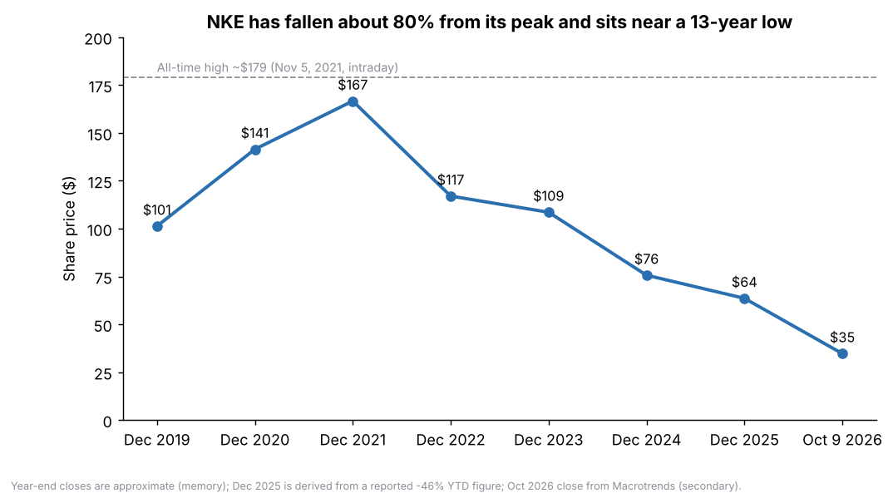

### Price facts (market data unless noted)
- **Last close:** **$35.35 on Monday, October 12, 2026.** The previous close was $34.71 on October 9.
- **52-week range:** $33.87 to $69.68 on closing prices; $31.97 to $70.44 intraday.
- **Record:** close of $177.51 and intraday high of $179.10, both November 5, 2021. Today's price is **80.1% below** the record close (my arithmetic).
- **2026 to date:** down **44.5%** from the 2025 year-end close of $63.71 (my arithmetic).
- **13-year low:** the October 2, 2026 close of $33.87 was the lowest since September 2013. The stock fell 3.6% that day, the session after Q1 FY2027 results (my arithmetic).
- **Filing-based return measure:** the proxy's pay-versus-performance table values $100 invested in NKE at the end of FY2021 at **$36.47** at the end of FY2026, against **$48.36** for the Dow Jones U.S. Footwear index. The NKE values by year are $122.26 (FY22), $109.51 (FY23), $100.23 (FY24) and $65.09 (FY25) (2026 proxy p. 56).
- **Index exit:** Nike left the S&P 100 before trading on September 21, 2026, announced September 4. It remains in the S&P 500 (secondary: Daily Tidings / Associated Press; S&P's own site was blocked).

### Valuation arithmetic (mine, so check it)
| Measure | Calculation | Result |
|---|---|---|
| Market capitalization | 1,485,308,829 shares (Q1 FY27 10-Q cover) x $35.35 | about **$52.5 billion** |
| Forward P/E on guidance midpoint | $35.35 / $1.25 | about **28x** |
| Dividend yield | $1.64 / $35.35 | about **4.6%** |
| Dividend vs guided EPS | $1.64 / $1.25 | about **131%** |
| FY2026 payout ratio | $1.63 declared (FY26 10-K) / $2.10 diluted EPS | about **78%** |

**Teaching point:** a 28x P/E is expensive for a shrinking company. It looks that way because profit is depressed. The bull case needs earnings to recover substantially; the bear case says they might not.

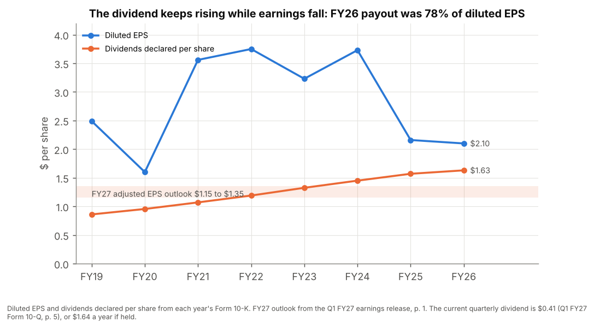

**Dividend.** Dividends declared per share rose every year: $0.86 (FY19), $0.955, $1.07, $1.19, $1.325, $1.45, $1.57 and $1.63 (FY26) (each year's 10-K). The November 2025 raise to $0.41 a quarter marked "the 24th consecutive year that NIKE has increased its quarterly dividend" (Nike release, Nov 2025). If FY2027 EPS lands near $1.25, the $1.64 annual dividend exceeds earnings. No cut has been announced; this is a risk, not a prediction.

### Analyst views (secondary, as of Oct 12, 2026)
- stockanalysis.com (S&P Global data, 42 analysts): consensus **Hold**, average target **$38.04**, low **$19**, high **$94**. MarketBeat (39 analysts): consensus **"Reduce"**, average **$41.07**. Ratings from the two aggregators differ, and the 27-analyst split quoted in the previous draft matched neither, so it is removed.
- After the Oct 1 results: Morgan Stanley cut its target to **$27** from $31 (Underweight); J.P. Morgan to $33 from $40 (Underweight); Bank of America to $24 from $30 (Underperform); Jefferies to **$60** from $75. Jefferies' Buy rating comes from its Sept 28 note (MarketBeat; stockanalysis).
- The previous draft's "EPS beat / revenue miss versus consensus" figures could not be verified on an opened page, so they are removed.

### Upcoming catalysts
- **Size-run re-checks: about Oct 24 and Nov 7, 2026.** Re-run `scripts/definitive/size_tracker/size_tracker.py` on the Air Jordan 1 Royal (released Oct 10) and the Air Jordan 12 Fireside (Oct 24); full size runs at full price on day 14 to 28 would meet the pre-registered disproof (Section 5.13).
- **Feng Tay monthly revenue: about the 10th of each month** (Taiwan exchange filing). A one-quarter lead indicator for Nike footwear (Section 5.13).
- **Investor Day: Nov 16 to 17, 2026.** "At our Investor Day on Nov. 16-17, we'll share more details" (Nike release, Oct 1, 2026 memo).
- **Q2 FY2027 results:** expected mid to late December. Nike had not announced a date by Oct 12; Dec 17 is an aggregator estimate. Nike flagged a Q2 revenue headwind of "approximately 400 basis points" from lapping EMEA Cyber Week promotions and higher North America sell-in a year earlier (Nike transcript, Q1 FY27 call).

---

## 7. People: the leadership thesis

**Why people are a useful indicator.** In a turnaround, financial results lag. Leadership decisions (who is hired, promoted, removed or leaves voluntarily) show what management believes and what the board thinks of it, and they can be observed in real time. This section treats people as a *leading indicator*, with one caveat: **leadership changes can signal either decisive repair or instability, and the facts alone cannot tell the two apart.**

**Three questions to ask of every executive move:**
1. Was it **planned** (a retirement with a named successor) or **abrupt** (a role eliminated, no stated reason)?
2. Does the **replacement** come from inside Nike or outside, and does the background fit the problem being solved?
3. Does it **reduce** layers of management (faster decisions) or **create** new ones?

**Leadership eras:**

| Era | CEO | Background | Philosophy |
|---|---|---|---|
| 2006 to Jan 2020 | **Mark Parker** | Joined 1979 as a footwear designer; now Executive Chairman (2026 proxy p. 9) | Product-led |
| Jan 2020 to Oct 2024 | **John Donahoe** | Outsider (Bain, eBay, PayPal, ServiceNow) | Digital and direct-to-consumer, data, membership |
| Oct 14, 2024 to now | **Elliott Hill** | Nike from 1988 to 2020, retired, then returned (8-K filed Sept 19, 2024) | Sport-first, wholesale partnerships, veteran team |

**How the board has judged it.** Hill's FY2026 summary-compensation total was **$36,340,876**, and the CEO pay ratio was **746 to 1** (2026 proxy pp. 41, 55). The board cut the FY2026 annual bonus to **74%** of target through "negative discretion" (2026 proxy pp. 25, 30). The FY2024 to FY2026 performance shares paid **0%**: Nike's relative shareholder return was "at the 1st percentile" (2026 proxy pp. 25, 34). At the September 8, 2026 meeting, say-on-pay received 736,936,017 votes for and 349,508,277 against, about 67.8% support, down from about 94% in 2025 (8-K filed Sept 10, 2026, p. 2; 2026 proxy p. 23). Director Thasunda Duckett had 310,517,784 votes withheld against 496,775,961 for (same 8-K).

---

## 8. Executive deep dives: current leadership

**Confidence tags:** HIGH = an SEC filing or an opened Nike page; MED = an opened news page; LOW = inferred. Nike publishes an official leadership roster at about.nike.com/en/company. As of Oct 12, 2026 it lists 21 people, and this section follows it. Full sources: `research_notes/02_current_exec_team.md`, `research_notes/01_ceo_and_board.md`, and the web-verification notes summarized in Section 13.

### Elliott Hill, President and CEO (since Oct 14, 2024)
- **Career (HIGH):** joined Nike in 1988; "Before retiring in 2020, he was President - Consumer and Marketplace, leading all commercial and marketing operations for Nike and Jordan Brand" (Nike profile). His retirement was announced Feb 18, 2020, and Heidi O'Neill took over his job on April 1, 2020 (secondary: Fortune, Feb 18, 2020). Earlier mid-career titles in the previous draft could not be verified on an opened page and are removed.
- **Return (HIGH):** appointed President and CEO effective Oct 14, 2024. Donahoe stayed as an adviser and non-executive employee until retiring January 31, 2025 (8-K filed Sept 19, 2024, pp. 2 to 3).
- **Pay terms (HIGH):** $1.5 million base salary, 200% target bonus, $15.5 million annual long-term incentive target, plus one-time awards of $3 million in RSUs and $4 million in cash (8-K filed Sept 19, 2024).
- **What he did on arrival:** reorganized teams around sport, rebuilt wholesale ties and brought back veterans. By June 2025 he "had made changes to 11 of his 15 direct reports" (secondary: Retail Dive).
- **Signal (my inference):** Hill's playbook is "put the band back together." Only three senior hires came from outside Nike.

### David Denton, EVP and CFO (since Aug 17, 2026; outside hire)
- **Career (HIGH):** CFO of Pfizer from May 2022, CFO of Lowe's from 2018 to 2022, and "two decades at CVS Health," where he was CFO from 2010 (Nike release, June 23, 2026; Lowe's release, 2018). Board seats: Tapestry and Haleon in the past; "Dave serves on the Board of Honeywell Aerospace" (Nike profile).
- **Start date:** August 17, 2026 (Aug 10, 2026 8-K; 2026 proxy p. 27; Nike release). The June 23, 2026 8-K says "effective as of August 16, 2026"; Friend's transition letter has Friend as CFO "through August 16" (8-K filed June 23, 2026). August 17 is the better-supported date.
- **Pay (HIGH):** $1.45 million base, 120% target bonus, $11.5 million FY2027 long-term incentive target, a $7.25 million one-time cash award and a $4 million performance-based cash award (2026 proxy; 8-K filed June 23, 2026).
- **Also:** interim Corporate Controller and principal accounting officer after Johanna Nielsen resigned effective Sept 4, 2026 "to pursue another opportunity" (8-K filed Aug 10, 2026, p. 2).
- **Notable:** his whole career is outside sporting goods, and he arrived six weeks before Pace was announced. Pfizer said he left "for a professional opportunity outside of the pharmaceutical industry in consumer goods" (secondary copy of Pfizer release). Full profile: `DEEP_DIVE_DENTON_EWING.md`.

### Venkatesh Alagirisamy, EVP and COO (since Dec 8, 2025; insider)
- **Career (HIGH):** a "nearly 20-year Nike veteran" who joined in 2006 in supply chain; later COO of Converse and Chief Supply Chain Officer (Nike release, Dec 3, 2025; Nike profile). Purdue MS, Duke MBA, BITS Pilani BE.
- **Remit (HIGH):** "Technology, in addition to his existing responsibilities leading Supply Chain, Planning, Operations, Manufacturing and Sustainability" (Nike release, Dec 3, 2025). He signed the April 2026 memo on technology job cuts (secondary: Fox).
- **Signal:** a supply-chain operator now runs operations and technology, consistent with Pace's operational focus.

### Jane Ewing, EVP and Chief Commercial Officer (since Sept 7, 2026; outside hire)
- **Career (HIGH):** "almost 14 years at Walmart," where she "held senior leadership roles spanning merchandising, digital acceleration and international operations." Before that she led one of Diageo's largest global divisions "for nearly nine years" (Nike release, Aug 27, 2026; WWD). She was interim CEO of Sam's Club China from February 2025 to January 2026, and in her final Walmart role led ethics and compliance for Walmart China (secondary: Talk Business). *Correction: the previous draft "corrected" away her merchandising and digital roles. Nike's own release lists them, so they are restored.*
- **Remit (HIGH):** Marketplace (Sales and NIKE Direct). "The geographies will continue to report directly to Hill" (WWD). Her role is therefore narrower than the eliminated CCO role held by Craig Williams, which included the geographies.
- **Signal (my inference):** a China-experienced retail operator hired into the channel that is declining fastest.

### Michael Gonda, EVP and Chief Communications and Strategy Officer (since July 7, 2025; outside hire)
- **Career (HIGH):** joined from McDonald's, replacing KeJuan Wilkins (Nike IR release; secondary: Retail Dive). His title on the roster now includes Strategy (Nike roster). *He was missing from the previous draft, which wrongly said Hill had made only two outside hires.*

### Amy Montagne, President, Nike (since May 5, 2025)
- About 20 years at Nike, most recently VP/GM Global Women's. "Before joining Nike, Montagne worked in allocation, planning, and merchandising at Gap Inc., Mervyn's, and Walmart" (Nike IR release, May 5, 2025). HIGH.

### Phil McCartney, EVP, Chief Innovation, Design and Product Officer (since May 2025)
- "A seasoned professional with 27 years of experience at Nike," VP of Nike Footwear since 2016 (Nike IR release, May 5, 2025). He took over the innovation remit of retiring John Hoke. Tony Bignell kept the separate Chief Innovation Officer title under him until leaving in April 2026, when Andy Caine replaced him on April 12, 2026 (secondary: Retail Dive).

### Nicole Hubbard Graham, EVP and Chief Marketing Officer
- 18 years at Nike, co-founded the agency Adopt in 2020, and rejoined as CMO in 2023 (Nike profile). That makes her a Donahoe-era hire whom Hill kept and promoted to EVP in May 2025.

### Tom Clarke, Chief Growth Initiatives Officer (since May 2025)
- Joined in 1980; President and COO from 1994 to 2000; President of Innovation for 11 years; strategic adviser to the CEO from 2023 (Nike profile). Still on the roster in October 2026 (HIGH).

### Regional heads (on the senior leadership team since Dec 2025)
| Region | Leader | Background | Hill link |
|---|---|---|---|
| North America | **Tom Peddie** (VP/GM) | About 30 years at Nike, retired 2020. **Rehired July 2024 under Donahoe**; named NA GM Oct 10, 2024, before Hill started (secondary: Retail Dive) | *Not a Hill hire (corrected)* |
| Greater China | **Cathy Sparks** (VP/GM) | Joined 1996 at Niketown Portland; VP/GM APLA from 2023; announced Jan 20, 2026 (Nike release) | Hill-era; replaced **Angela Dong** (joined 2005; left Mar 31, 2026) |
| EMEA | **César García** (VP/GM, Feb 2, 2026) | Started "nearly 25 years ago as an EKIN in Spain"; ran APLA, Global Running and Western Europe (Nike release, Jan 20, 2026) | Replaced retiring **Carl Grebert** (joined 1997) |
| APLA | **Cristin (Crissy) Campbell** (interim) | About 15 years; began as a graduate intern (Nike profile) | Still interim in Oct 2026 |

### Brand and functional leaders
- **Sarah Mensah, President, Jordan Brand** (since May 2023; not a Hill hire). Joined Nike in 2013 after 19 years with the Portland Trail Blazers; Albertsons director (Nike profile). Jordan revenue was $7,034 million in FY2026, down 3% and 19% below the FY2024 peak on the same basis (FY26 10-K p. 32; my arithmetic; Section 5.12).
- **Aaron Cain, President and CEO, Converse** (since July 2025), a 21-year Nike veteran. Hill called Jared Carver's exit "a joint decision" (secondary: Retail Dive). Converse revenue was $1,692 million in FY2025, down 19% (FY25 10-K p. 33), and $1,174 million in FY2026.
- **Treasure Heinle, EVP and Chief People Officer** (Jan 2025, succeeding Monique Matheson; announced Nov 25, 2024). Joined 2012; HR roles at Danaher, Tektronix and InFocus (Nike profile).
- **Rob Leinwand, EVP and Chief Legal Officer** (from late 2024, succeeding Ann Miller). Joined 2004; earlier at Littler Mendelson (Nike profile).
- **Ann Miller, EVP, Global Sports Marketing** (from Oct 2024, succeeding John Slusher). Joined 2007 (Nike profile).
- **Jennifer Hartley, VP, Chief Strategy Officer** (since April 2025). Ex-McKinsey, at Nike since 2011, replacing Daniel Heaf (Nike profile; secondary: Retail Dive).
- **Running and sport leaders:** no person-level running or sport leads were found. This is a gap, given that running is central to the turnaround story.

### Board of directors
- **Mark Parker, Executive Chairman** (2026 proxy p. 9). He picked Donahoe in 2019 and Hill in 2024; in my judgment accountability for both choices sits with him (inference).
- **Tim Cook is Lead Independent Director**: "In June 2025, the Board re-appointed Mr. Timothy Cook to serve as Lead Independent Director for a term of three years" (2026 proxy p. 15). This was unverified in the previous draft.
- **Changes:** Cathleen Benko retired and Jørgen Vig Knudstorp (former LEGO CEO) was elected, both effective Sept 9, 2025 (8-K filed June 18, 2025, p. 2). John Rogers Jr. left the board at the Sept 8, 2026 meeting and stays as an adviser (8-K filed June 18, 2026, p. 2). **Alexandre Arnault**, Deputy CEO of Moët Hennessy, was appointed on **Sept 15, 2026**, effective immediately, raising the board to 12; the announcement came Sept 16 (8-K filed Sept 16, 2026, p. 2).
- **Founder control:** Swoosh, LLC holds 78.8% of Class A shares (2026 proxy p. 70).
- **Signal (my inference):** the two newest directors come from consumer brands and luxury (LEGO, LVMH), suggesting the board wants brand-building expertise.

### Past CEO: John Donahoe (CEO Jan 2020 to Oct 2024)
- Bain (CEO from 1999), eBay CEO, PayPal chair, and ServiceNow CEO from February 2017 (secondary: Wikipedia). He joined Nike's board in 2014.
- At Nike: the direct-to-consumer push; the Dec 2023 plan for "up to $2 billion in cumulative cost savings" (8-K filed Dec 21, 2023). His retirement was announced Sept 19, 2024; he was an adviser until Jan 31, 2025 (8-K filed Sept 19, 2024).
- Afterwards: named Stanford athletic director on July 31, 2025 (secondary: ABC7, Fortune).

---

## 9. Executive deep dives: departures

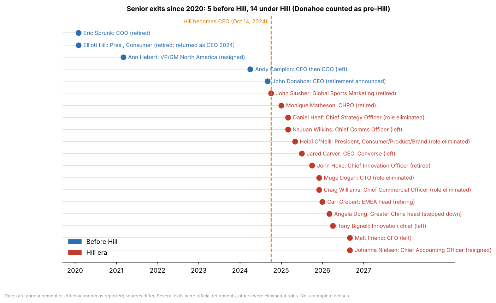

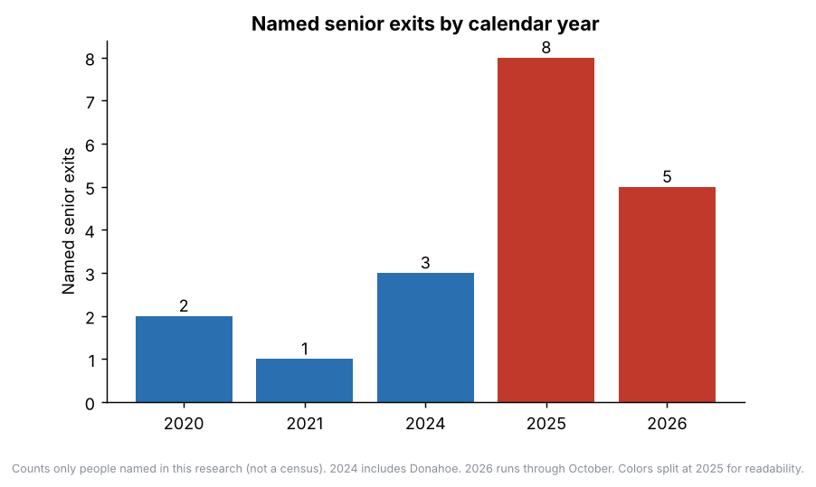

*Counts the people named in this research, not a complete census. Each row's source is in `data/people_events.csv`. Official reasons are separated from reported reasons.*

| Person | Role | Date | Official reason | Reported or other | Next | Successor |
|---|---|---|---|---|---|---|
| **Eric Sprunk** | COO | Announced Feb 18, 2020 | Retirement | n/a | Unknown | Andy Campion |
| **Elliott Hill** | President, Consumer and Marketplace | Announced Feb 18, 2020 | Retirement | His own account: needed a break | Returned as CEO Oct 2024 | Heidi O'Neill (Apr 1, 2020) |
| **Ann Hebert** | VP/GM North America | Mar 2021 | Resigned | Followed reports about a family member's sneaker resale business (secondary; snippet only) | Unknown | n/a |
| **Andy Campion** | COO, later strategic ventures | Apr 2024 | Separation; "one-time cash compensation amount of $2,750,000" (Q2 FY24 10-Q p. 47) | Link to cost cuts is inference only | UCLA Anderson program (secondary) | n/a |
| **John Donahoe** | CEO | Announced Sept 19, 2024 | Retirement (8-K filed Sept 19, 2024) | Followed weak guidance | Stanford athletic director | Elliott Hill |
| **John Slusher** | EVP Global Sports Marketing (since 1998) | Announced Oct 30, 2024 | Retirement | One of several 25-plus-year veterans leaving after Hill arrived | Unknown | Ann Miller |
| **Monique Matheson** | Chief Human Resources Officer (26 years) | Jan 2025 | Retirement | Same cluster | Unknown | Treasure Heinle |
| **Daniel Heaf** | Chief Strategy and Transformation Officer | About Mar 2025 | Not stated by Nike | Role reported as eliminated | **CEO of Bath & Body Works** (May 2025) | **Jennifer Hartley** (Apr 2025) |
| **KeJuan Wilkins** | Chief Communications Officer | About Mar 2025 | No public statement | n/a | Unknown | **Michael Gonda** (July 7, 2025) |
| **Heidi O'Neill** | President, Consumer, Product and Brand (26 years) | Ceased May 2, 2025; separated Sept 5, 2025 | 8-K: role eliminated, treated as an involuntary termination without cause; Nike release: "decided to retire" (8-K filed May 5, 2025, p. 2) | Both framings are official | **CEO of Lululemon** (from Sept 8, 2026) | Role split three ways |
| **Jared Carver** | CEO, Converse | July 2025 | "A joint decision" (Hill memo) | Converse sales weak | Unknown | Aaron Cain |
| **John Hoke** | Chief Innovation Officer (joined 1995) | Through Oct 31, 2025 | Retirement | Same May 2025 batch | Unknown | Tony Bignell, reporting to McCartney |
| **Muge Dogan** | Chief Technology Officer (joined 2023 from Amazon) | Announced Dec 2, 2025 | Role eliminated; "will leave the company" (8-K filed Dec 2, 2025) | Hill: remove layers | Unknown | COO took technology |
| **Craig Williams** | Chief Commercial Officer | Stopped Dec 5, 2025; separated Apr 6, 2026 | Role eliminated (8-K filed Dec 2, 2025, p. 2) | Sales and Direct moved to the CFO | Unknown | Jane Ewing (narrower role, Sept 2026) |
| **Carl Grebert** | VP/GM EMEA (joined 1997) | Announced Jan 20, 2026 | Retirement (Nike release) | "Carl shared his thinking with me some time ago" (Hill) | Unknown | César García |
| **Angela Dong** | VP/GM Greater China (joined 2005) | Effective Mar 31, 2026 | "Decided to pass the baton" (Nike release) | Greater China declining | Unknown | Cathy Sparks |
| **Tony Bignell** | Chief Innovation Officer (under a year) | Replaced Apr 12, 2026 | "To pursue creative and philanthropic passions" (secondary) | BNP analyst called it a "real surprise" | Unknown | Andy Caine |
| **Matthew Friend** | EVP and CFO | CFO through Aug 16, 2026; adviser until Sept 4, 2026 | "Not the result of any disagreement with Company management or the Company's board of directors"; $2,000,000 transition benefit plus severance plan benefits (8-K filed June 23, 2026, pp. 2 to 3) | Analysts called it a surprise | Unknown | David Denton |
| **Johanna Nielsen** | VP, Chief Accounting Officer and Corporate Controller | Effective Sept 4, 2026 | Resigned "to pursue another opportunity" (8-K filed Aug 10, 2026, p. 2) | n/a | Unknown | Denton (interim) |

**Friend's career:** joined Nike in 2009 and spent "more than 15 years at Nike" (Nike release, Dec 2025), becoming CFO in the February 2020 reshuffle (secondary: Fortune, Feb 18, 2020). The reason for his exit was not stated beyond "not the result of any disagreement."

**2018 context (outside the window):** Trevor Edwards and Jayme Martin left in 2018 during a workplace-conduct probe, which is part of why Nike's culture and senior bench have been scrutinized (from the previous draft; not re-verified).

---

## 10. Patterns in the people data

**These are my observations from the evidence. Each is labelled with how strong it is.**

1. **The exits accelerate after the CEO change (strong).** 5 of the 19 named exits came before Hill took over (2020 to Sept 2024) and 14 after. Calendar 2025 alone had eight. *Caution:* a new CEO normally reshapes the team, and many exits were announced retirements of 25-year to 30-year veterans. Hill himself said he "made changes to 11 of his 15 direct reports" by June 2025 (secondary: Retail Dive).

2. **"Role eliminated" is a distinct signal (strong).** O'Neill, Dogan and Williams were removed through role eliminations disclosed in 8-Ks; Heaf's role was reported as eliminated. Two of those functions were then partly re-created: a Chief Strategy Officer (Hartley, Apr 2025) and a Chief Commercial Officer (Ewing, Sept 2026, with a narrower remit than Williams had). *My inference:* this may reflect learning (a layer removed, then a needed capability restored) or indecision.

3. **Hill promotes insiders and veterans (strong).** Montagne, McCartney, Alagirisamy, Sparks, García, Campbell, Cain, Heinle, Leinwand and Hartley are long-tenured Nike people. *Correction:* Peddie was rehired under Donahoe in July 2024, not by Hill. *The risk:* the people who ran Nike while it declined are among those now fixing it.

4. **Outside hires sit in communications, finance and commercial (strong).** Gonda (McDonald's), Denton (Pfizer, Lowe's, CVS) and Ewing (Walmart, Diageo) all come from outside sportswear. *My inference:* management believes it needs operating and communications discipline from outside, while product and brand knowledge must come from inside.

5. **Finance turned over within one quarter (strong on facts, cause unknown).** The CFO change was announced June 23, 2026; Denton started Aug 17; Friend left Sept 4. A separate 8-K reported the chief accounting officer's resignation effective the same day (8-Ks filed June 23 and Aug 10, 2026). Nike said Friend's exit was not due to a disagreement. **I found no evidence of any accounting problem, and I am not suggesting one.** But two departures at the top of finance just before a $2.5 billion restructuring is a pattern a diligent analyst would ask about at Investor Day.

6. **Shareholders are signalling dissatisfaction (strong).** Say-on-pay support fell from about 94% to about 67.8% in one year, and the FY2024 to FY2026 performance shares paid nothing (8-K filed Sept 10, 2026; 2026 proxy pp. 23, 25). Shareholders can hold the board to account even under founder control.

7. **Nike talent is valued elsewhere (medium).** Heidi O'Neill became CEO of Lululemon (from Sept 8, 2026) and Daniel Heaf became CEO of Bath & Body Works. Maggie Gauger, who spent two decades at Nike before running Athleta, was named Lululemon's President and Chief Product Officer in October 2026 (secondary: FashionUnited).

8. **Greater China leadership changed after the revenue decline (medium).** The China head of two decades left, a 30-year insider replaced her, and partner-run online storefronts end in January 2027.

9. **The board chose both CEOs (strong).** Parker and the board picked an outsider in 2019 and an insider in 2024. The newest directors come from LEGO and LVMH.

**What the people data does *not* tell you:** whether the products are better, whether customers are returning, or whether Nike will regain share against On, Hoka, Adidas and local Chinese brands. Section 12 covers that.

---

## 11. Scenario framework (illustrative)

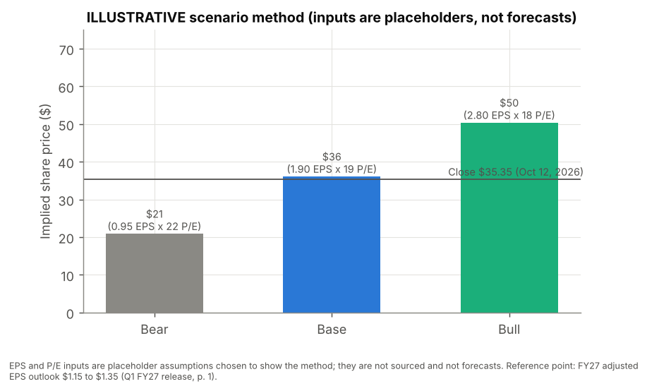

**This chart demonstrates a method only. The EPS and P/E inputs are placeholder assumptions I chose, not forecasts and not sourced.** A sourced, scenario-based valuation of one business line, Jordan, built on the repo's reverse DCF conventions, is in Section 5.12 and `research_notes/13_jordan_valuation.md`. The only sourced reference points are the FY2027 adjusted EPS outlook of $1.15 to $1.35 (Q1 FY27 release p. 1) and the $35.35 close (market data).

**How the method works:** a share price roughly equals the **EPS** investors expect times the **P/E multiple** they will pay. Bear, base and bull cases choose different combinations.

| Case | FY28 EPS (placeholder) | P/E (placeholder) | Implied price | What would have to be true |
|---|---|---|---|---|
| Bear | $0.95 | 22x | about $21 | Revenue keeps falling; discounting hurts margin; dividend cut |
| Base | $1.90 | 19x | about $36 | Revenue stabilizes; Pace savings begin; China bottoms |
| Bull | $2.80 | 18x | about $50 | Running and wholesale rebound; margin recovers toward the 44% to 45% of FY2024 (FY24 10-K p. 33); Converse and China stabilize |

**To make this defensible** you need sourced assumptions for revenue by region, gross margin, operating expenses after Pace savings, share count and a P/E range justified by comparable companies.

---

## 12. What else to investigate

Ordered by value for a case built on the leadership thesis:

**Answered in the October 13, 2026 research round** (details in the notes cited):
- *Is North America wholesale growth real sell-through or channel fill?* Mostly channel fill: Nike North America wholesale grew 9% to 24% a quarter while Foot Locker, JD North America, Academy footwear and Shoe Carnival comps ran -7% to +1%, and DICK'S liquidated about $260 million of Foot Locker inventory (`research_notes/thesis_tests/retailer_sell_through.md` Section C).
- *Why did North America's gross margin rise while every other region's fell?* The $965 million tariff refund; excluding it, North America fell to 40.9% (`research_notes/15_why_nike_discounts.md`).
- *Why is Nike discounting, and when does full price return?* `research_notes/15_why_nike_discounts.md` and `research_notes/16_full_price_recovery.md`; a definitive-test programme is in `DEEP_DIVE_DEFINITIVE_TESTS.md`.

**Still open:**
- *Definitive tests still to finish* (`DEEP_DIVE_DEFINITIVE_TESTS.md`): the Air Jordan 4 control for the resale panel (Test 4), the size-run re-checks of post-cut releases (Test 3), and the full time-to-markdown history beyond the 91-colourway priority subset (Test 2).
- Why did Greater China collapse?
- Why did NIKE Direct shrink?
- What is NIKE Direct's average markdown depth, measured against the 8% to 16% break-even range?
- Why did U.S. customer concentration jump?
- Why did the other regions' gross margins fall?
- Why is footwear falling faster than apparel?

1. **Product and innovation evidence.** Running share against On, Hoka and Adidas; new franchise launches; sell-through.
2. **Competitor benchmarks.** Adidas ran a similar turnaround, which gives a useful timeline. Also Puma, Lululemon, New Balance, Asics, Deckers (Hoka), On, and Anta and Li-Ning in China.
3. **Retailer signals.** What Foot Locker, Dick's and JD Sports say on their own earnings calls; retailers see demand before Nike reports it.
4. **Consumer and brand health.** Web traffic, app downloads, search trends, resale prices and social sentiment.
5. **Inventory and discounting.** Inventory rose about 5% from May to August 2026 while revenue fell (Section 5.6).
6. **China.** Local brand competition and the January 2027 online channel change.
7. **People gaps.** Running and sport leaders at person level; Donahoe's specific hires; where departed executives went; employee sentiment.
8. **Jordan Brand (Section 5.12).** Re-price the 247-shoe resale sample each quarter and add the holiday 2026 retros; pair counts per release (not public); Jordan units, price or inventory at Investor Day; JD and DICK'S launch commentary for November 2026 to January 2027.
9. **Primary documents still to read:** the Investor Day materials (Nov 16 to 17) and the Q2 FY2027 10-Q and release.

---

## 13. Data quality and what changed in this version

**Method.** 102 SEC documents were downloaded (originally from sec.gov; downloads now use the investors.nike.com mirror, per `CLAUDE.md`) and read in full by nine readers working in parallel, each covering every page of its assigned filings. They extracted about 9,300 data points, each with a page and a verbatim quote. A script then checked that every value appears on the cited page of the cited filing, and every number printed in a filing passed. The remaining flags were derived values the readers had labelled as their own arithmetic. Values were cross-checked across filings (each 10-K repeats prior years) and against SEC XBRL data. Where filings disagree because of later reclassification (for example, Jordan Brand revenue and FY2023 digital revenue), the table uses the figure as first reported and notes the restatement.

**Added on October 13, 2026:**
- New Sections 5.7 to 5.10 on regional profitability, channel economics, Converse and product.
- Chart 15.
- `data/nike_region_profitability.csv`.
- Seven new filing facts: the FY2022 and FY2023 NIKE Direct gross margin bridge values.
- Research notes 06 to 10.
- Two filing dates were corrected against the SEC filing index before entry.
- Filings are now downloaded from Nike's investor-site copy of EDGAR, with no personal contact information sent.
- Peer data comes from annual report PDFs and company IR documents. A few Under Armour quotes were read through a web tool and not checked against a downloaded copy; `10_peer_channel_margins.md` marks them.

**Added later on October 13, 2026: definitive tests.** Section 5.13, chart 20, `DEEP_DIVE_DEFINITIVE_TESTS.md`, `data/definitive/` (factory orders, units vs price, time to markdown, size runs, resale panel) and `scripts/definitive/` (including the re-runnable size tracker). Test 4 is directional only until its Air Jordan 4 control is collected.

**Corrections to the previous draft (all verified against the filings unless noted):**
- FY2020 diluted EPS was **$1.60**, not $1.62 (FY20 10-K).
- Q2 FY2024 diluted EPS was **$1.03**, not $1.07; Q3 FY2024 was **$0.77**, not $0.99; Q4 FY2024 was **$0.99**, not $0.98; Q1 FY2025 gross margin was **45.4%**, not 44.7%.
- FY2024 segment revenue: North America **21,396** (not 21,369), EMEA **13,607** (not 13,695), Greater China **7,545** (not 7,547), APLA **6,729** (not 6,543). FY2024 wholesale was **27,758** (the old ~27,400 was the FY2023 figure).
- FY2026 segments replaced aggregator estimates: North America **20,511**, EMEA **12,572**, Greater China **5,847**, APLA **6,243**, Converse **1,174** (FY26 10-K p. 32).
- Q1 FY2027 revenue was **$11,213 million**, not $11,210 million; APLA was -2% reported and 0% currency-neutral.
- Dividends declared per share: FY20 **$0.955** (not 0.98), FY21 **$1.07** (not 1.10), FY22 **$1.19** (not 1.22). FY23 to FY26 are now filled in.
- Greater China has declined for **nine** straight quarters, not eight. Nike says Greater China actions "extend beyond fiscal 2027," not "throughout" it.
- Shares outstanding (1.485 billion), Tim Cook as lead independent director, the $1.5 billion annualized tariff estimate, and the $2 billion Dec 2023 savings target are now confirmed in filings.
- Arnault's appointment date is Sept 15, 2026 (announced Sept 16).
- People (opened Nike and news pages): Hill made **three** outside hires, not two (Gonda added); Heaf's successor was Jennifer Hartley and he became CEO of Bath & Body Works; Wilkins's successor was Gonda; Peddie was rehired under Donahoe in July 2024; Ewing's merchandising and digital roles are restored; Sprunk's and Hill's retirements were announced Feb 18, 2020; Bignell's successor started Apr 12, 2026; the "Aug 2024" layoff was Aug 2025; Graham co-founded Adopt in 2020.
- The stock chart now uses actual daily closes instead of remembered year-end prices. The layoff-count chart was replaced with filing-based headcount, because filings never state layoff numbers.

**Added October 13, 2026:**
- Sections 5.11 (revenue streams) and 5.12 (Jordan Brand), charts 16 and 17, `research_notes/11_revenue_streams.md`, `research_notes/12_jordan_brand_thesis.md` and `research_notes/jordan_extracts/`.
- **Jordan data fix.** `revenue_jordan` in `data/nike_filing_facts.csv` holds first-reported values, so FY2023 and FY2024 are on the wholesale equivalent basis and FY2025 and FY2026 on the reported basis. Chaining them gives FY2025 growth of +4% instead of the filed -16%. A consistent series, `revenue_jordan_reported_basis` (FY2023 to FY2026), was added from the FY25 and FY26 10-Ks.
- **Restored after verification on Nike's official Q1 FY27 transcript:** the Q2 FY2027 revenue headwind of "approximately 400 basis points" from lapping EMEA Cyber Week promotions and North America sell-in, and Pace savings peaking in FY2029 and FY2030 (both previously dropped as unverifiable).
- **Audit fixes (Oct 13):** North America gross margin now shown excluding the tariff refund; role eliminations counted as three confirmed plus one reported; North America wholesale sell-in verdict added to Sections 4 and 12; Jordan downside corrected to $1.90 to $3.40 a share.
- **Jordan scenario valuation added** (Section 5.12, chart 19, `research_notes/13_jordan_valuation.md`, `scripts/jordan_valuation.py`, `data/valuation/jordan_scenarios.csv`, `data/valuation/jordan_sensitivity.csv`, `data/valuation/peer_ev_ebit_20261013.csv`). Branches eloquent-feynman, wonderful-franklin, stoic-shannon and zealous-mccarthy were merged; revenue streams and Jordan became Sections 5.11 and 5.12, notes 11 to 13 and charts 16 to 19.
- **Jordan evidence test added.** Ten research lines (Foot Locker, DICK'S, JD Sports, other retailers, resale prices, release counts, FY2018 analog, alternative explanations, peers, consumer interest), chart 18, and data files `data/jordan_resale_goat_20261013.csv`, `data/google_trends_jordan_julsep.csv`, `data/jordan_retro_release_counts_annual.csv` and `data/piper_sandler_nike_teen_mindshare.csv`. The Jordan thesis changed from "deliberate scarcity reset" to "oversupply, then a supply cut that has not yet worked". A personal email address was removed from a methods note, and research no longer sends one in requests.
- Dropped as unverifiable: "more than 700 Jordan styles a year in 2022 and 2023" (traced only to an unsourced blog). SneakerPing's 605 Jordan items are a resale sample, not a release count.
- Market claims in Section 5.12 come from opened pages; claims seen only in search snippets (for example, Evercore's Jordan reasoning and Piper Sandler's 2026 schedule) are excluded.

**Removed because they could not be verified:**
- The Q1 FY2027 consensus figures ($0.43 EPS, $11.32 billion revenue).
- The 27-analyst rating split.
- Hill's unverified mid-career titles.
- The "8,000 staff" Sport Offense figure.

**Still open:**
- **Ann Hebert's exit reason:** seen only in a search snippet.
- **The Mississippi part of the January 2026 layoffs:** the count is unverified.
- **Q2 FY2027 report date:** not yet announced by Nike.

**Nothing in this report is investment advice.** The scenario chart illustrates a method only.

---

## 14. Glossary

| Term | Meaning |
|---|---|
| **8-K** | A filing public companies submit to the SEC to announce material events (results, executive changes, restructurings). |
| **10-K / 10-Q** | Annual and quarterly financial reports filed with the SEC. |
| **Adjusted (non-GAAP)** | A figure that excludes items management treats as unusual, such as restructuring costs. |
| **Basis point (bps)** | 1/100 of a percentage point. |
| **Bull / bear case** | Optimistic and pessimistic scenarios. |
| **Currency-neutral** | Growth excluding exchange-rate effects. |
| **Demand creation** | Nike's term for advertising, marketing and athlete endorsement spending. |
| **DTC / NIKE Direct** | Selling directly to customers through Nike's own stores, app and website. |
| **EBIT** | Earnings before interest and taxes (operating profit). |
| **EPS** | Earnings per share. |
| **Fiscal year (FY)** | Nike's runs June 1 to May 31. |
| **Gross margin** | Revenue minus cost of sales, divided by revenue. |
| **Guidance** | A company's forecast of its own results. |
| **IEEPA tariffs** | Tariffs imposed under the International Emergency Economic Powers Act. The Supreme Court ruled them unauthorized on Feb 20, 2026, and Nike booked a $986M expected recovery in Q4 FY2026. |
| **Market cap** | Share price times shares outstanding. |
| **P/E ratio** | Price divided by EPS. |
| **Payout ratio** | Dividends divided by earnings. |
| **Proxy statement (DEF 14A)** | The annual filing describing the board, executive pay and shareholder votes. |
| **Say-on-pay** | The advisory shareholder vote on executive pay. |
| **TSR** | Total shareholder return: price change plus dividends. |
| **WARN notice** | A state filing employers must make before large layoffs. |
| **Wholesale** | Selling through other retailers. |

---

## 15. Sources

**SEC filings (all read in full; downloads now come from the investors.nike.com mirror of EDGAR).** The per-number citations are in `data/nike_filing_facts.csv`; the most-cited filings are:

| Filing | Filed | URL |
|---|---|---|
| FY2026 10-K | 2026-07-15 | https://www.sec.gov/Archives/edgar/data/320187/000032018726000088/nke-20260531.htm |
| FY2025 10-K | 2025-07-17 | https://www.sec.gov/Archives/edgar/data/320187/000032018725000047/nke-20250531.htm |
| FY2024 10-K | 2024-07-25 | https://www.sec.gov/Archives/edgar/data/320187/000032018724000044/nke-20240531.htm |
| FY2023 10-K | 2023-07-20 | https://www.sec.gov/Archives/edgar/data/320187/000032018723000039/nke-20230531.htm |
| FY2022 10-K | 2022-07-21 | https://www.sec.gov/Archives/edgar/data/320187/000032018722000038/nke-20220531.htm |
| FY2021 10-K | 2021-07-20 | https://www.sec.gov/Archives/edgar/data/320187/000032018721000028/nke-20210531.htm |
| FY2020 10-K | 2020-07-24 | https://www.sec.gov/Archives/edgar/data/320187/000032018720000047/nke-531202010k.htm |
| FY2019 10-K | 2019-07-23 | https://www.sec.gov/Archives/edgar/data/320187/000032018719000051/nke-531201910k.htm |
| Q1 FY2027 10-Q | 2026-10-02 | https://www.sec.gov/Archives/edgar/data/320187/000032018726000193/nke-20260831.htm |
| Q1 FY2027 release (8-K Ex. 99.1) | 2026-10-01 | https://www.sec.gov/Archives/edgar/data/320187/000032018726000184/q1fy27exhibit991er.htm |
| Pace 8-K (Item 2.05) | 2026-10-01 | https://www.sec.gov/Archives/edgar/data/320187/000032018726000184/nke-20261001.htm |
| Q4 FY2026 release (8-K Ex. 99.1) | 2026-06-30 | https://www.sec.gov/Archives/edgar/data/320187/000032018726000076/q4fy26exhibit991er.htm |
| 2026 proxy (DEF 14A) | 2026-07-15 | https://www.sec.gov/Archives/edgar/data/320187/000032018726000089/nke-20260715.htm |
| CFO transition 8-K | 2026-06-23 | https://www.sec.gov/Archives/edgar/data/320187/000032018726000070/nke-20260616.htm |
| Chief accounting officer 8-K | 2026-08-10 | https://www.sec.gov/Archives/edgar/data/320187/000032018726000112/nke-20260804.htm |
| Annual meeting vote results 8-K | 2026-09-10 | https://www.sec.gov/Archives/edgar/data/320187/000032018726000143/nke-20260908.htm |
| Arnault appointment 8-K | 2026-09-16 | https://www.sec.gov/Archives/edgar/data/320187/000032018726000170/nke-20260915.htm |
| Dec 2025 leadership 8-K | 2025-12-02 | https://www.sec.gov/Archives/edgar/data/320187/000032018725000115/nke-20251201.htm |
| CEO transition 8-K | 2024-09-19 | https://www.sec.gov/Archives/edgar/data/320187/000032018724000053/nke-20240919.htm |
| Dec 2023 restructuring 8-K | 2023-12-21 | https://www.sec.gov/Archives/edgar/data/320187/000032018723000054/nke-20231221.htm |

The full list of 102 documents with URLs is in `research_notes/04_financial_data_pack.md` (Section 8) and in `data/nike_filing_facts.csv`.

**Nike pages (opened)**
- [Nike leadership roster](https://about.nike.com/en/company) and individual profile pages under about.nike.com/en/company/people/
- [CFO transition release](https://about.nike.com/en/newsroom/releases/nike-inc-announces-planned-cfo-transition)
- [Aug 27, 2026 leadership announcement](https://about.nike.com/en/newsroom/releases/nike-inc-august-27-2026-senior-leadership-announcement)
- [Dec 3, 2025 leadership announcement](https://about.nike.com/en/newsroom/releases/nike-inc-december-3-2025-senior-leadership-announcement)
- [Jan 20, 2026 geography leadership announcement](https://about.nike.com/en/newsroom/releases/nike-inc-january-20-2026-geography-leadership-announcement)
- [Oct 1, 2026 corporate announcement (Pace memo)](https://about.nike.com/en/newsroom/releases/nike-inc-corporate-announcement-october-1-2026)
- Nike investor-relations releases: [May 5, 2025 leadership](https://investors.nike.com/news-events/press-releases/detail/547), [Gonda](https://investors.nike.com/news-events/press-releases/detail/549), [Nov 2025 dividend](https://investors.nike.com/news-events/press-releases/detail/556), [Arnault](https://investors.nike.com/news-events/press-releases/detail/574)

**Nike earnings call transcripts (official IR PDFs, opened)**
- Q4 FY23 (June 29, 2023), Q4 FY24 (June 2024), Q2 FY26 (Dec 18, 2025), Q3 FY26 (Mar 31, 2026), Q4 FY26 (June 2026) and Q1 FY27 (Oct 1, 2026), from investors.nike.com. Quote-level detail: `research_notes/jordan_extracts/JORDAN_MARKET_FINDINGS.md`.

**Jordan secondary and data-provider pages (opened)**
- [Sherwood News, Oct 5, 2026 (Telsey)](https://sherwood.news/snacks/newsletters/nikes-plan-to-make-jordans-cool-again/)
- [Reuters via Cyprus Mail, Sept 28, 2023 (StockX resale premiums)](https://cyprus-mail.com/2023/09/28/nike-air-jordans-are-losing-resale-value-is-sneaker-culture-moving-on)
- [Lyst Index Q2 2026](https://www.lyst.co.uk/the-lyst-index/q2-26/)
- [Nike release: World of Flight Philadelphia](https://about.nike.com/en/newsroom/releases/jordan-brand-world-of-flight-philadelphia)

**Market data**
- Yahoo Finance chart API, NKE daily prices from Jan 2, 2019 to Oct 12, 2026 (`data/nke_daily_prices.csv`, `data/nke_dividends_exdate.csv`)

**News and other pages (opened)**
- [Retail Dive: leadership changes under Hill](https://www.retaildive.com/news/nike-ceo-elliott-hill-leadership-team-turnaround-changes/750495/)
- [Retail Dive: CFO change](https://www.retaildive.com/news/nike-surprise-cfo-change-david-denton-turnaround-progress/823650/)
- [Retail Dive: Q1 FY27 and Pace, BNP comment](https://www.retaildive.com/news/nike-turnaround-visibility-very-low-layoffs-sales-declines-q1-earnings/832015/)
- [Retail Dive: distribution-center layoffs](https://www.retaildive.com/news/nike-layoffs-distribution-centers-tennessee-mississippi/810593/)
- [Retail Dive: Peddie returns (July 2024)](https://www.retaildive.com/news/nike-tom-peddie-returns-vice-president-marketplace-partners-dtc-wholesale/720981/)
- [Retail Dive: Bignell exits, Caine named](https://www.retaildive.com/news/nike-innovation-chief-tony-bignell-exits-andy-caine-turnaround/817310/)
- [Retail Dive: Cain named Converse CEO](https://www.retaildive.com/news/nike-names-aaron-cain-ceo-converse-jared-carver-exits/752800/)
- [Tennessee WARN notice, NIKE Retail Services](https://www.tn.gov/content/dam/tn/workforce/documents/warn/NIKE-Retail-Services.pdf)
- [Fortune: Feb 2024 layoffs](https://fortune.com/2024/02/16/nike-lays-off-more-than-1500-people-ceo-john-donahoe/)
- [Fortune: Feb 2020 reshuffle](https://fortune.com/2020/02/18/nike-executive-job-reshuffling/)
- [WWD: Ewing named CCO](https://wwd.com/footwear-news/shoe-industry-news/nike-chief-commercial-officer-jane-ewing-walmart-1239172832/)
- [Talk Business: Ewing leaving Walmart](https://talkbusiness.net/2026/09/walmart-senior-advisor-leaving-to-join-nike/)
- [Daily Tidings: S&P 100 removal](https://www.dailytidings.com/oregon-giant-nike-to-be-dropped-from-sp-100-after-stock-sinks-nearly-80/)
- [Just Style: China online changes](https://www.just-style.com/news/nike-says-it-will-streamline-online-business-in-china/)
- [FashionUnited: Heaf to Bath & Body Works](https://fashionunited.com/news/people/daniel-heaf-succeeds-gina-boswell-as-bath-body-works-ceo/2025052066113)
- [stockanalysis.com: NKE forecast](https://stockanalysis.com/stocks/nke/forecast/) and [MarketBeat: NKE forecast](https://www.marketbeat.com/stocks/NYSE/NKE/forecast/)

---

## Repository contents

| Path | What it is |
|---|---|
| `REPORT.md` | This report |
| `DEEP_DIVE_DENTON_EWING.md` | Deep dive on CFO David Denton and CCO Jane Ewing |
| `data/nike_filing_facts.csv` | 6,281 filing facts, one per metric and period, each with filing, printed page, URL and verbatim quote |
| `data/nke_daily_prices.csv`, `data/nke_dividends_exdate.csv` | Market data (Yahoo Finance), pulled Oct 12, 2026 |
| `data/people_events.csv` | The named-exit list behind charts 6 and 7, with a source per row |
| `data/nike_channel_split.csv`, `data/nike_region_profitability.csv` | Revenue by segment and channel; region-by-year revenue, Direct share, EBIT and gross margin (built by `scripts/build_region_channel.py`) |
| `DEEP_DIVE_DEFINITIVE_TESTS.md` | Five pre-registered tests of the supply cut and full-price recovery (Section 5.13) |
| `data/definitive/`, `scripts/definitive/` | Data and scripts for those tests, including the re-runnable size tracker |
| `charts/` | 20 charts, all generated from the files in `data/` |
| `scripts/make_charts.py` | Rebuilds every chart (`pip install matplotlib numpy`, then `python3 scripts/make_charts.py`) |
| `scripts/build_data_pack.py` | Rebuilds `research_notes/04_financial_data_pack.md` from the facts file |
| `research_notes/` | Research notes; `04_financial_data_pack.md` is the cited financial tables, `06` to `10` cover regional profit, products, Converse and channel margins, `11_revenue_streams.md`, `12_jordan_brand_thesis.md` and `13_jordan_valuation.md` cover revenue mix, Jordan and its valuation, `14` to `16` cover the profit bridge, discounting and full-price recovery; `thesis_tests/` holds retailer, valuation, marketing, alt-data, review-tone and say-vs-do tests; `reports/` holds the execution vs structural report |
